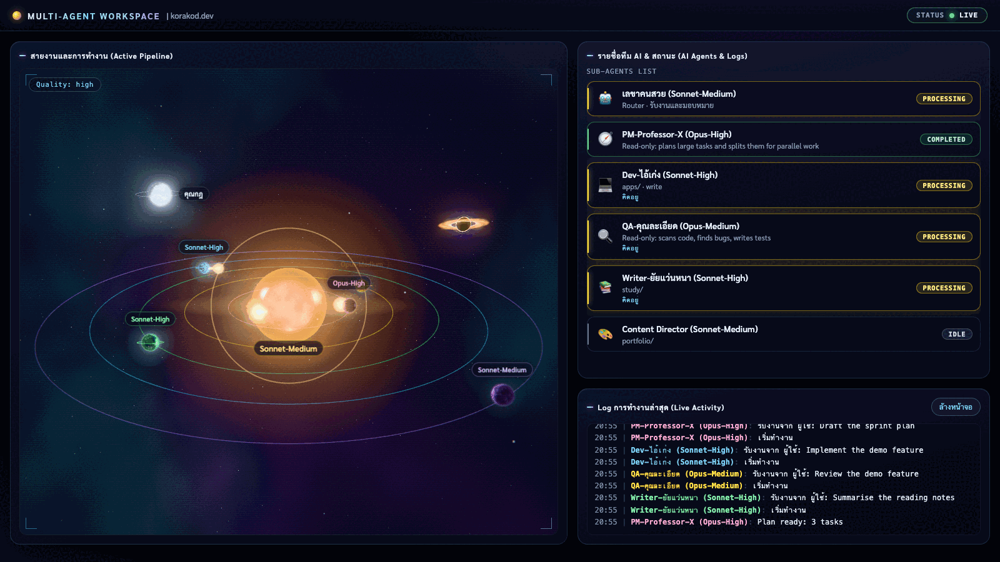
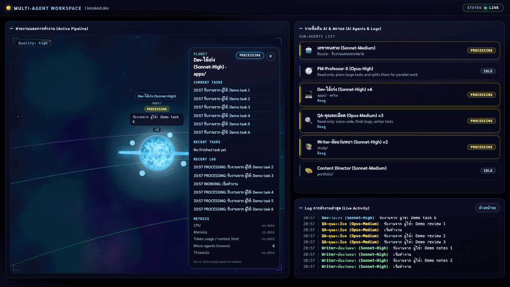

# AI Team for Claude Code

**English summary.** A personal multi-agent setup for [Claude Code](https://claude.com/claude-code): one secretary agent
(the only agent the owner talks to) routes every request to specialist agents (planner, developer, QA reviewer, study writer,
portfolio writer). Each specialist has its own folder scope, model and effort level, all defined as Markdown files in
`.claude/agents/`. The repo also contains `agent-dashboard`, a zero-dependency Node.js app that turns Claude Code hook events
into a live 3D view (planets = agents, moons = concurrent instances, beams = tool calls). It runs on `127.0.0.1` only.
Screenshots below use synthetic demo events.



---

## ภาพรวม

repo นี้คือชุดทีม AI สำหรับ Claude Code: ผู้ใช้คุยกับ **เลขาคนสวย** คนเดียว เลขาไม่ลงมือทำงานเอง (ไม่มีเครื่องมือแก้ไฟล์หรือ shell)
แต่ทำหน้าที่จ่ายงานให้ผู้เชี่ยวชาญแต่ละคน แล้วสรุปผลกลับมา ผู้เชี่ยวชาญแต่ละคนทำงานได้เฉพาะโฟลเดอร์ของตน
และมี `model` กับ `effort` กำหนดไว้ในไฟล์ของตัวเอง

> ไฟล์ agent เขียนด้วยภาษาอังกฤษเป็นหลัก ส่วนการสื่อสารกับเจ้าของและเอกสารใช้ภาษาไทย (กติกากลางอยู่ใน `CLAUDE.md`)

## ทีม agent

ค่า model/effort อ่านจาก frontmatter ของแต่ละไฟล์ใน `.claude/agents/`

| ชื่อ (`name`) | บทบาท | Model | Effort | ขอบเขต / เครื่องมือ |
| :- | :- | :- | :- | :- |
| เลขาคนสวย | จุดติดต่อเดียว รับคำสั่งแล้วจ่ายงาน ไม่ทำงานเอง | sonnet | medium | มีเฉพาะ `Agent(...)` สำหรับเรียกผู้เชี่ยวชาญ |
| PM-Professor-X | วางแผนงานโค้ดขนาดกลางถึงใหญ่ แบ่งเป็นงานย่อยที่ทำขนานกันได้ คืนเป็นแผน ไม่เขียนโค้ด | opus | high | อ่านอย่างเดียว (`Read`, `Glob`, `Grep`) |
| Dev-ไอ้เก่ง | เขียน แก้ และ debug แอป/สคริปต์ | sonnet | high | ทำงานใน `apps/` |
| QA-คุณละเอียด | ตรวจโค้ดและเอกสาร หา bug เขียน test case | opus | medium | อ่านอย่างเดียว (Bash ไว้รัน test ที่มีอยู่เท่านั้น) |
| Writer-ยัยแว่นหนา | งานเรียน: รายงาน สรุป เตรียมสอบ ค้นคว้า | sonnet | high | ทำงานใน `study/` |
| Content Director | เนื้อหาพอร์ตโฟลิโอ: write-up โปรเจกต์ case study โพสต์สั้น | sonnet | medium | ทำงานใน `portfolio/` (อ่าน `apps/` ได้ แก้ไม่ได้) |

ลำดับงานที่เลขาใช้ (จาก `.claude/agents/secretary.md`):

- งานโค้ดเล็ก: เลขา -> Dev-ไอ้เก่ง
- งานโค้ดกลางถึงใหญ่: เลขา -> PM-Professor-X (วางแผน) -> Dev-ไอ้เก่ง หลาย instance ขนานกัน -> Dev หนึ่งตัวรวมงานและรัน test -> QA-คุณละเอียด ตรวจ
- งานหลายขั้น: ต่อ chain (เช่น Dev สร้าง -> QA ตรวจ) งานที่ไม่เกี่ยวกัน: จ่ายขนาน

## โครงสร้างโฟลเดอร์

```
.claude/
  agents/            ไฟล์นิยาม agent (secretary, pm, app-dev, qa-reviewer, study-writer, portfolio-writer)
  settings.json      ตั้งเลขาคนสวยเป็น agent หลัก และอนุญาต Edit/Write
  settings.local.json  (ไม่ถูก commit) hook ของ dashboard บนเครื่องของคุณ
CLAUDE.md            กติกากลางที่ทุก agent อ่าน
apps/                งานพัฒนาแอป (Dev-ไอ้เก่ง)
  agent-dashboard/   dashboard แบบ live (ดูด้านล่าง)
study/               งานเรียน (Writer-ยัยแว่นหนา) มีแค่ .gitkeep ใน repo สาธารณะ เนื้อหางานเรียนไม่ถูกเผยแพร่
portfolio/           เนื้อหาพอร์ตโฟลิโอ (Content Director)
```

## วิธีใช้ทีม

1. clone repo นี้ แล้วเปิด terminal ที่ root ของ repo
2. รัน `claude` ( `.claude/settings.json` ตั้ง `"agent": "เลขาคนสวย"` ไว้แล้ว) ถ้าเลขาไม่ขึ้นเป็น agent หลักให้รัน `claude --agent เลขาคนสวย`
3. สั่งงานกับเลขาอย่างเดียว เช่น "สร้างสคริปต์นับคำแล้วให้ QA ตรวจ"

เปลี่ยน model หรือ effort ของ agent ได้ด้วยการแก้บรรทัด `model:` / `effort:` ในไฟล์ใต้ `.claude/agents/` (dashboard อ่านค่าเหล่านี้ไปแสดงในป้ายชื่อ)
ต้องการเพิ่ม agent: สร้างไฟล์ใหม่ใน `.claude/agents/` แล้วเพิ่มชื่อใน `tools: Agent(...)` และตารางส่งงานของเลขา

## Agent Dashboard

`apps/agent-dashboard/` คือ dashboard แบบ live ที่แสดงว่าใครมอบหมายงานให้ใคร ข้อมูลมาจาก Claude Code hooks
ใช้ Node.js built-ins เท่านั้น (ไม่มี dependency, ไม่มี build step) และ bind ที่ `127.0.0.1` เท่านั้น

- ฉาก 3D: ดวงอาทิตย์ = เลขาคนสวย, ดาวเคราะห์ = agent, ดวงจันทร์ = instance ที่ทำงานพร้อมกัน, ดาวหาง = การมอบหมายงาน, หลุมดำ = งานที่ล้มเหลว
- activity effects: pulse ตอนคิด, ลำแสงต่อ tool call, burst ตอน instance จบ
- ป้ายชื่อแสดง `(Model-Effort)` ตาม frontmatter ของ agent, ถ้าไม่มี WebGL จะแสดงเป็นรายการแทน
- POST ทุก route ต้องใช้ token ที่สุ่มใหม่ทุกครั้งที่ start, ข้อความใน event ถูก redact แบบ best effort



### วิธีรัน

ต้องใช้ Node.js 18.18 ขึ้นไป ไม่ต้อง `npm install`

```bash
cd apps/agent-dashboard
npm start                      # http://127.0.0.1:4317
DASHBOARD_PORT=0 npm start     # ให้ OS เลือกพอร์ตว่าง (banner แสดงพอร์ตจริง)
npm run replay                 # เล่น sample session โดยไม่ต้องมี hooks
npm test                       # tests ใช้ไฟล์ชั่วคราวเท่านั้น
```

ต่อกับ Claude Code จริง: ใส่ hook block ใน `.claude/settings.local.json` ตาม [`HOOKS-SETUP.md`](apps/agent-dashboard/HOOKS-SETUP.md)
(ระดับโปรเจกต์เท่านั้น hook เรียก wrapper `bin/hook.sh`) รายละเอียดทั้งหมด (routes, env, security, privacy, ข้อจำกัด) อยู่ใน
[`apps/agent-dashboard/README.md`](apps/agent-dashboard/README.md)

### ความเป็นส่วนตัวของข้อมูล

dashboard เก็บ event ไว้ที่ `apps/agent-dashboard/data/events.jsonl` ซึ่งมีข้อความงานสั้น ๆ และอยู่ใน `.gitignore` (ไม่ถูก commit)
อย่าคัดลอกโฟลเดอร์ `data/` ไปที่ที่ใช้ร่วมกัน ภาพหน้าจอใน repo นี้สร้างจาก event สังเคราะห์เท่านั้น

## ข้อควรรู้

- Bash ไม่ได้ allow ไว้ใน `.claude/settings.json` Claude Code จะถามอนุมัติทุกครั้ง (ตั้งใจ)
- กติกากลาง (ภาษา ขอบเขตโฟลเดอร์ การตอบสั้น ห้ามแต่งข้อเท็จจริง) อยู่ใน [`CLAUDE.md`](CLAUDE.md)
- `study/` และ `portfolio/` เป็นพื้นที่ทำงานของเจ้าของ ใน repo สาธารณะนี้เป็นโฟลเดอร์ว่าง (`.gitkeep`) เท่านั้น เนื้อหางานเรียนอยู่นอก repo (`study/*` อยู่ใน `.gitignore`) ไม่ได้เป็นส่วนของตัวอย่างนี้
