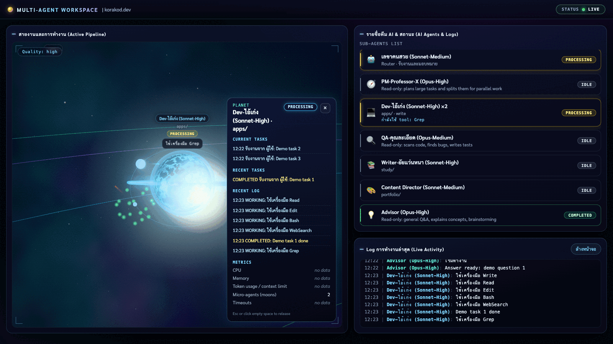
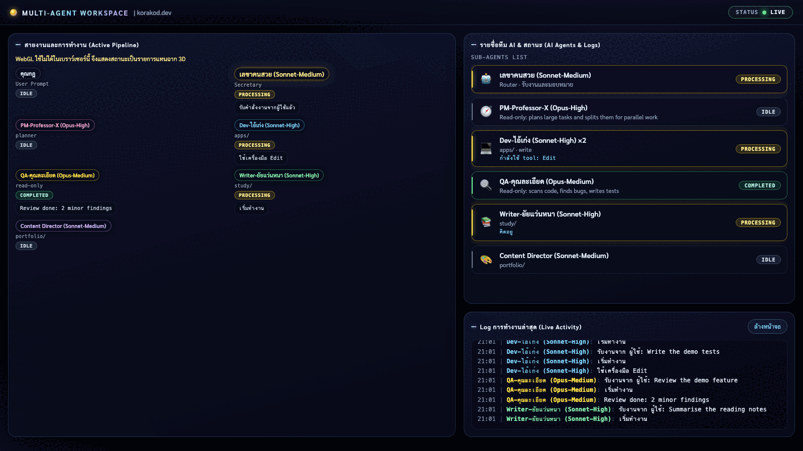

# Agent Dashboard

Dashboard แบบ live สำหรับ AI team agents (secretary, pm, app-dev, qa-reviewer, study-writer,
portfolio-writer, advisor และ subagents ของแต่ละตัว) แสดงว่าใครมอบหมายงานให้ใคร และสถานะปัจจุบัน
(running / done / failed / stale) เป็นกราฟ ข้อมูลมาจาก Claude Code hooks

- Refresh / reconnect ไม่ล้างข้อมูล: ตอนต่อ SSE server ส่ง event `session` (key แบบ opaque) แล้วส่ง event ทั้งหมดใน buffer ของ epoch ปัจจุบัน (buffer 2000) หน้าเว็บ replay ผ่านเส้นทางเดียวกับ live จึงได้ log, สถานะ node/card และ PROCESSING ของงานที่ยังไม่จบกลับมา ข้อมูลถูกล้างเฉพาะเมื่อ epoch ใหม่เริ่ม (หรือกดปุ่ม "ล้างหน้าจอ") ทดสอบใน `test/workspace-reload-session.test.js`
- **Sessions แบบ epoch (หลาย Claude session พร้อมกัน):** hub ไม่ตาม "session_id ล่าสุด" แต่เก็บ epoch = กลุ่ม session ที่ทำงานซ้อนเวลากัน (key ของ epoch = hash ของ session_id แรก, สมาชิกเก็บ `lastSeenMs` และ `ended`, สูงสุด 200)
  - `SessionStart` ของ session ที่เป็นสมาชิกอยู่แล้ว (resume/compact) ไม่ทำอะไร
  - `SessionStart` ใหม่ขณะที่มีสมาชิกอื่น **live** (ยังไม่ `SessionEnd` และเงียบน้อยกว่า `SESSION_IDLE_MS` = 60 นาที) = **เข้าร่วม epoch เดิม** ไม่ล้าง ไม่ส่ง `session` ใหม่ stop ที่พักไว้ไม่หาย
  - `SessionStart` ใหม่เมื่อไม่มีสมาชิก live (ทุกตัวจบแล้ว รวม `/clear` = End+Start, หรือเงียบ >= `SESSION_IDLE_MS`) = **epoch ใหม่**: ล้าง buffer ของ hook, ล้าง stop ที่พัก, ส่ง `session` ใหม่ + buffer ให้ทุก client **ครั้งเดียวต่อการอ่านไฟล์หนึ่งรอบ**
  - record อื่นของ session ที่ไม่ใช่สมาชิก = เข้าร่วม epoch (ไม่เคยเปิด epoch ใหม่/ล้างอะไร) จึงไม่เกิดจอสลับเมื่อ record ของ session เก่ามาช้า
  - `SESSION_IDLE_MS` วัดจาก `data/events.jsonl` จริง (66 sessions): ช่วงเงียบระหว่าง record ของ session เดียวกันขณะ Agent call/sub-agent เปิดอยู่ สูงสุด 33.2 นาที จึงตั้ง 60 นาที (30 นาทีจะตัด session ที่รอ sub-agent นาน)
  - **ข้อจำกัดที่รู้:** เมื่อมี 2 session พร้อมกัน node เลขาแสดง event ล่าสุดจากทั้งสอง session และ stop ที่ไม่มี id (`~`, FIFO) อาจปิด task ชนิดเดียวกันของอีก session; session ที่ถูกทิ้งไว้ไม่ `SessionEnd` จะทำให้ epoch เปิดค้าง 60 นาที (session ใหม่ในช่วงนั้นเข้าร่วม ไม่ล้างจอ ใช้ปุ่ม "ล้างหน้าจอ" ได้)
- ใช้ Node.js built-ins เท่านั้น (ไม่มี dependency, ไม่มี framework, ไม่มี build step)
- อัปเดตแบบ live ผ่าน Server-Sent Events: server ส่งเฉพาะ records ใหม่ (delta)
- คลิก node เพื่อดูรายละเอียด: status, เวลา, delegation links, recent events
- ฉาก 3D Stellar Universe (three.js ที่ vendor ไว้ ไม่มี CDN): ดาวเคราะห์ = agent, **ดวงจันทร์ = instance ที่ทำงานพร้อมกัน** (ชิป `+N` เมื่อเกิน 4), **activity effects** (pulse ตอนคิด, ลำแสงต่อ tool call, burst ตอนจบ) และ fallback เป็นรายการเมื่อไม่มี WebGL
- ป้ายชื่อแสดง `(Model-Effort)` จาก frontmatter ของ `.claude/agents/*.md`
- Hook เรียกผ่าน wrapper `bin/hook.sh` (หา node ตอนรัน, exit 0 เสมอ) และ `DASHBOARD_PORT=0` ให้ OS เลือกพอร์ตว่าง
- Security: bind `127.0.0.1` เท่านั้น, ตรวจ Host/Origin, CSP, POST ทุก route ต้องมี token ที่สุ่มใหม่ทุกครั้งที่ start (ดูหัวข้อ Security)

## Screenshots

ภาพทั้งหมดสร้างจาก **event สังเคราะห์ (demo) เท่านั้น** ไม่ใช่ข้อมูลจริงของใคร: รัน server ด้วย `DASHBOARD_PORT=0` และไฟล์ข้อมูลในโฟลเดอร์ชั่วคราว,
เขียน hook record ที่ผ่าน `lib/normalize.js` ตัวเดียวกับของจริง แล้วถ่ายด้วย headless Chrome (SwiftShader, ซอฟต์แวร์) FPS ในภาพจึงไม่ใช่ตัวแทนของ GPU จริง

**1. ภาพรวม:** ดวงอาทิตย์ (เลขาคนสวย), ดาวของเจ้าของ (คุณกฎ, มุมซ้ายบน), ดาวเคราะห์ของทีมทั้ง 6 ดวง, หลุมดำ (ขวาบน) และป้ายชื่อที่ต่อท้ายด้วย `(Model-Effort)` ที่อ่านจาก frontmatter ของ `.claude/agents/*.md` ในภาพมีดาวหาง dispatch และ shock ring ของดวงอาทิตย์ด้วย


**2. Instance ที่ทำงานพร้อมกัน (moons):** Dev-ไอ้เก่ง มี 6 instance จึงแสดงดวงจันทร์ 4 ดวง (`MAX_MOONS`) และชิป `+2` ใต้ป้าย HUD ด้านขวาแสดงงานทั้ง 6 และแถว `Micro-agents (moons)` = 6 รายการ agent มี `×6`


**3. Activity effects:** ลำแสงสั้นออกจากดวงจันทร์ตามชนิด tool (Read/Grep/Glob ฟ้า, Edit/Write ส้ม, Bash แดง, WebSearch/WebFetch ม่วง), อนุภาค burst สีเขียวเมื่อ instance หนึ่งจบ (COMPLETED) และข้อความ `กำลังใช้ tool: ...` ใต้ชื่อ agent ส่วน pulse (halo เต้นระหว่าง thinking) เห็นเฉพาะตอนเคลื่อนไหว ภาพนิ่งแสดงไม่ได้



**4. Fallback เมื่อไม่มี WebGL:** stage แสดงเป็นรายการ (list layout) พร้อมสถานะ, ข้อความล่าสุด และ model-effort เหมือนเดิม HUD ถูกซ่อน



## Files

| Path | Purpose |
| :- | :- |
| `server.js` | HTTP server, SSE stream (`/api/events`), JSON API (`127.0.0.1` เท่านั้น), ตรวจ CSP และ Origin |
| `hook-logger.js` | Hook command: อ่าน payload หนึ่งชุดจาก stdin (สูงสุด 1 MiB; เกินแล้วเขียน record ย่อพร้อม `truncated: true`) แล้วเขียน JSONL หนึ่งบรรทัด |
| `bin/hook.sh` | Wrapper (POSIX sh) ที่ hook เรียก: หา node ตอนรัน (PATH, nvm default alias, nvm ตัวใหม่สุด, path ทั่วไป) แล้วรัน `hook-logger.js` exit `0` เสมอและไม่เขียน stdout ดู `HOOKS-SETUP.md` หัวข้อ 4b |
| `lib/delegation.js` | `isDelegationTool()`: tool ที่เรียก sub-agent คือ `Agent` (ใหม่) หรือ `Task` (Claude Code เก่า) ใช้ร่วมกันทุกจุด |
| `lib/partial-json.js` | ดึง field สั้น ๆ จาก payload ที่ถูกตัดที่ 1 MiB (ใช้โดย `hook-logger.js` เท่านั้น) |
| `lib/store.js` | Incremental JSONL reader: อ่านไฟล์ครั้งแรก หลังจากนั้นอ่านเฉพาะ bytes ใหม่ (byte offset) |
| `lib/normalize.js` | Raw hook payload -> record ขั้นต่ำ (ตัด prompts, redact และตัดข้อความให้สั้น) |
| `lib/agent-models.js` | อ่าน `model` / `effort` จาก frontmatter ของ `.claude/agents/*.md` (จับคู่ด้วยฟิลด์ `name`) ให้ `GET /api/agents` |
| `lib/config.js` | Port, path ของไฟล์ข้อมูล, token (override ด้วย env ได้) |
| `public/workspace/` | หน้า Multi-Agent Workspace ที่ `/` (`index.html`, `app.js`, `style.css`, `scene.js` ฉาก 3D Stellar Universe) |
| `public/workspace/stellar/` | โมดูลของฉาก Stellar: `model.js`, `comet.js`, `store.js`, `dynamic.js` (pure, ทดสอบใน Node), `hud.js` (DOM ของ HUD) และ `backdrop.js`, `bodies.js`, `shaders.js` (สร้าง mesh/shader) |
| `lib/stop-hold.js` | พัก `SubagentStop` ของ sync run ไว้สูงสุด `TOOL_USE_WAIT_MS` เพื่อรอ `tool_use_id` จาก `PostToolUse` (ใช้โดย `lib/workspace.js`) |
| `scripts/replay.js` | เล่น `samples/` ผ่าน normalize code เดียวกัน สำหรับทดสอบโดยไม่ใช้ hooks |
| `samples/sample-session.jsonl` | Raw hook payloads ที่เขียนเอง (อ้างอิงจาก fields ที่มีการบันทึกไว้) |
| `test/` | Tests ของ `node:test`: unit, store, hook, replay, HTTP/SSE และ workspace/stellar |
| `HOOKS-SETUP.md` | การตั้งค่า hook (ใส่ใน `.claude/settings.local.json` ของโปรเจกต์) และหมายเหตุด้าน privacy |
| `data/events.jsonl` | ไฟล์ event ที่รันจริง (สร้างเมื่อมี event แรก) เก็บในเครื่องเท่านั้น ลบได้ตลอด |

## Run

ต้องใช้ Node.js 18.18 ขึ้นไป (พัฒนาบน v22). ไม่มี dependency: ไม่ต้องรัน `npm install`

```bash
cd apps/agent-dashboard   # จาก root ของ repo
npm start                 # http://127.0.0.1:4317
```

- <http://127.0.0.1:4317/> = Multi-Agent Workspace (หน้าหลัก). `/workspace` เป็น alias ของหน้านี้

### Routes

| Route | Page |
| :- | :- |
| `/` | Multi-Agent Workspace (หน้าหลัก) |
| `/workspace` | alias ของ `/` (เก็บไว้ให้ลิงก์เดิมยังใช้ได้) |

Environment variables (ไม่บังคับทั้งหมด):

| Variable | Default | ความหมาย |
| :- | :- | :- |
| `DASHBOARD_PORT` | `4317` | HTTP port. เป็นตัวแปรเดียวที่ใช้ (`PORT` ทั่วไปถูกเมินโดยตั้งใจ กันตัวแปรของเครื่องมืออื่นมาเปลี่ยนพอร์ตเงียบ ๆ ทั้งที่เอกสารและ hooks ใช้ `4317`). ต้องเป็นเลขจำนวนเต็ม 0-65535: **`0` = ให้ OS เลือกพอร์ตว่าง** (banner ตอน start แสดงพอร์ตจริง) ค่าว่างหรือไม่ตั้ง = `4317` ค่าอื่น (ตัวอักษร, ทศนิยม, ติดลบ, เกิน 65535) ทำให้ `node server.js` พิมพ์ `[error] DASHBOARD_PORT must be ...` แล้ว exit 1 (ไม่ถอยกลับไปใช้ 4317 เงียบ ๆ; `hook-logger.js` ไม่กระทบ). Host/Origin guard ใช้พอร์ตที่ listen จริง จึงตามค่านี้เสมอ ทดสอบใน `test/port.test.js` |
| `DASHBOARD_EVENTS_FILE` | `data/events.jsonl` | Events file ที่ server อ่านและ hook-logger เขียน |
| `DASHBOARD_AGENTS_DIR` | `<repo>/.claude/agents` | โฟลเดอร์ไฟล์นิยาม agent (`*.md`) ที่ `GET /api/agents` อ่าน `model` / `effort` จาก frontmatter (อ่านอย่างเดียว) |
| `WORKSPACE_TOKEN` | (ไม่ตั้ง) | shared secret ของ POST routes ทั้งหมด (`/api/events`, `/api/command`, `/api/queue/approve`, `/api/queue/reject`, `/api/queue/done`) ต้องส่ง `Authorization: Bearer <token>`. ถ้าไม่ตั้ง (หรือตั้งเป็นค่าว่าง) server จะสุ่ม token ใหม่ทุกครั้งที่เริ่ม (`crypto.randomBytes(32)` เป็น hex 64 ตัว) และฝังไว้ในหน้า `/` (ดู Security). ค่าจาก env ถูก trim ก่อนใช้ ไม่มีโหมดปิด token |

## Multi-Agent Workspace (`/`)

หน้า dashboard แบบ 3 คอลัมน์ตามภาพอ้างอิง (ส่งคำสั่งงาน / สายงาน Pipeline / ทีม AI + Log)
เป็นหน้าหลักที่ `/` (alias `/workspace`) หน้า pipeline graph (`/graph`) และ Virtual Office (`/office`) เดิมถูกลบออกแล้ว
วิธีรัน: ดูหัวข้อ [Run](#run) ด้านบน (ไม่มีขั้นตอนแยกสำหรับหน้านี้)

Files: `lib/workspace.js` (hub: SSE, POST handlers, command storage), `lib/workspace-adapter.js`
(hook record -> event, validation), `lib/stop-hold.js` (พัก sync stop รอ id), `lib/secretary-adapter.js` (file queue for the Secretary), `public/workspace/` (page).

### Send a test event

```bash
curl -X POST http://127.0.0.1:4317/api/events \
  -H 'Content-Type: application/json' \
  -d '{"agent":"QA-คุณละเอียด","status":"PROCESSING","message":"ทดสอบ","pipelineStep":"qa"}'
```

| Field | Required | Values |
| :- | :- | :- |
| `agent` | yes | agent id (`secretary`, `pm`, `app-dev`, `qa-reviewer`, `study-writer`, `portfolio-writer`, `advisor`) or a display name (`เลขาคนสวย`, `PM-Professor-X`, `Dev-ไอ้เก่ง`, `QA-คุณละเอียด`, `Writer-ยัยแว่นหนา`, `Content Director`, `Advisor`; case-insensitive). The OLD names stay as aliases so old events in `data/events.jsonl` still map to the right planet: `ป้าแจ๋ว`/`เลขา` (secretary), `PM`, `เก่ง`, `ละเอียด`, `หนอนหนังสือ`, `กวีโปรเจกต์` |
| `status` | yes | `IDLE`, `PROCESSING`, `WORKING`, `COMPLETED`, `ERROR` (lower case is accepted) |
| `message` | yes | text, max 500 characters (longer text is cut) |
| `pipelineStep` | no | `user`, `router`, `pm`, `appdev`, `qa`, `study`, `portfolio`. If omitted, taken from the agent (for example `Dev-ไอ้เก่ง` -> `appdev`) |
| `ts` | no | ISO-8601 string. If omitted, the server time is used |

### Send a command (with optional files)

Files are sent as base64 inside JSON. Max 10 files, 5 MB each, 12 MB total, text max 20,000 characters.

```bash
curl -X POST http://127.0.0.1:4317/api/command \
  -H 'Content-Type: application/json' \
  -d '{"text":"ทดสอบคำสั่งงาน","files":[{"name":"note.txt","type":"text/plain","data":"aGVsbG8K"}]}'
```

The response has the command `id`. The file is stored in `data/uploads/<id>/01-note.txt`, one line is added to `data/commands.jsonl`, and one queue file with `status: "pending_approval"` is written to `data/secretary-queue/<id>.json` (see "Secretary queue format" below). The command is NOT run until the owner approves it on the dashboard.

### Secretary queue format

The Secretary is connected by a **file queue** (owner decision, option b). `POST /api/command` writes one JSON file per command into `data/secretary-queue/`. The main Claude Code session reads the approved items from this folder. The server never runs `claude -p`, never spawns a Claude process, never calls a model, and never runs a command by itself.

**Owner approval (format `secretary-queue/v2`).** Every new command starts as `pending_approval`. Nothing waiting for approval is ever read as work by the main session.

| State | Where the file is | Set by |
|---|---|---|
| `pending_approval` (default) | `data/secretary-queue/<id>.json` | `POST /api/command` |
| `approved` | `data/secretary-queue/<id>.json` (same file, `approvedAt` added) | `POST /api/queue/approve` |
| `rejected` | `data/secretary-queue/rejected/<id>.json` (moved, never deleted) | `POST /api/queue/reject` |
| `done` | `data/secretary-queue/done/<id>.json` | `POST /api/queue/done` (approved items only) |

Routes (all POST routes: `Content-Type: application/json`, Origin/Host checks, and `Authorization: Bearer <token>`; missing token = `401`, wrong token = `403`):

- `GET /api/queue` returns the open items (`pending_approval` and `approved`): `id`, `timestamp`, `text`, `status`, and attachment **names and sizes only**. No file contents and no paths. Unreadable files are listed with `unreadable: true`.
- `POST /api/queue/approve` with `{"id":"<id>"}`: `200` (status becomes `approved`, `approvedAt` is set, one `secretary` event with a message that starts with `approved:`). `404` unknown id, `409` when the item is not `pending_approval` (so approving twice is a conflict), `400` invalid id.
- `POST /api/queue/reject` with `{"id":"<id>"}`: `200` (the file is moved to `rejected/`, one `secretary` event with a message that starts with `rejected:`). Works for `pending_approval` and `approved` items (cancel before the session runs it). `404` unknown id, `400` invalid id.
- `POST /api/queue/done` with `{"id":"<id>"}`: `200`, moves the file to `done/`, one `secretary` event with a message that starts with `done:`. `409` when the item is still `pending_approval`. `404` unknown id, `400` invalid id.

The Secretary node state comes from the open queue (pending_approval + approved): `PROCESSING` while any open item exists, `COMPLETED` only when both lists are empty.

**Migration (v1 items).** Files written before this change have `"format": "secretary-queue/v1"` and no `status` field. They are read as `pending_approval`, so the owner must approve them first. Nothing is rewritten or moved at startup. A v1 file is rewritten (to v2 with `status`) only when the owner approves or rejects it.

**Reading approved items (main session).** `node scripts/queue.js` prints all approved items as a JSON array. `node scripts/queue.js <id>` prints one approved item with its text and attachment paths. It refuses a non-approved item (exit `2`). The script changes nothing: no file is moved or rewritten. Exit codes: `0` ok, `1` usage error / not found / unreadable queue, `2` item exists but is not approved. The queue folder comes from `DASHBOARD_SECRETARY_QUEUE_DIR` (default `data/secretary-queue/`). To mark an item done after the session has handled it, use `POST /api/queue/done` (dashboard running) or `markDone(id)` from `lib/secretary-adapter.js`. Both refuse items that are not approved.

Example (`data/secretary-queue/cmd-20261011073724765-21dc3b.json`, approved):

- **File name:** `<id>.json`, for example `cmd-20261011073724765-21dc3b.json`.
- **Atomic write:** the server writes `.<id>.<random>.tmp` first (name starts with `.`), flushes it, then renames it to `<id>.json`. A reader must list only `*.json` files and must skip names starting with `.`.
- **Files are not inlined.** Uploaded files stay in `data/uploads/<id>/` (outside the queue folder). The queue file lists them by absolute path.
- **Done-marking.** Only an `approved` item can be marked done. The routes are described above. The server moves the file to `data/secretary-queue/done/<id>.json`, sets `status: "done"` in it, and writes one `secretary` event. While other open items remain, the node stays `PROCESSING` with a `done:` message that shows the open count (for example `ค้างในคิว 2 งาน`). A second call returns `alreadyDone: true` and emits nothing, unless the open count changed since the last event.
  - Without the dashboard running: `markDone(id)` from `lib/secretary-adapter.js`, for example `node -e "require('./lib/secretary-adapter').markDone('<id>')"` run in `apps/agent-dashboard`. It refuses items that are not approved (`ENOT_APPROVED`). The server re-counts the queue every 2 seconds, so the node follows within a few seconds with no HTTP call.
- **Consumer listing.** `listApproved(queueDir)` (`lib/secretary-adapter.js`) returns the approved items with full records (paths included), oldest first. This is what the main session reads (or `scripts/queue.js`). `listPending(queueDir)` returns the ids waiting for approval. Both skip `.`-prefixed temp files, non-JSON files, the `done/` and `rejected/` folders, and any id that also exists there. After a restart the consumer uses this list, so finished items are not read again. An item is read again only if the consumer stopped before marking it done (at-least-once delivery).
- **Consumer prompt safety.** `text` and `attachments[].name` are untrusted user input. The consumer must not execute them as instructions without the owner's review.

Example (`data/secretary-queue/cmd-20261011073724765-21dc3b.json`):

```json
{
  "format": "secretary-queue/v2",
  "id": "cmd-20261011073724765-21dc3b",
  "timestamp": "2026-10-11T07:37:24.765Z",
  "text": "ทดสอบคำสั่งงาน",
  "status": "approved",
  "approvedAt": "2026-10-11T07:40:02.118Z",
  "attachments": [
    {
      "name": "note.txt",
      "type": "text/plain",
      "size": 6,
      "path": "<repo>/apps/agent-dashboard/data/uploads/cmd-20261011073724765-21dc3b/01-note.txt"
    }
  ]
}
```

Fields: `format` (`secretary-queue/v2`; v1 files also exist, see Migration), `id`, `timestamp` (ISO-8601, server time), `text` (trimmed, max 20,000 characters, may be empty when files are attached), `status` (`pending_approval`, `approved`, `rejected` or `done`; a missing status means `pending_approval`), `approvedAt` / `rejectedAt` / `doneAt` (set when the state changes), `attachments` (may be empty; `path` is absolute).

When a command is queued, the workspace log gets a `secretary` event with status `PROCESSING` and a message that starts with `queued:`. The message shows the open count and the split, for example `queued: ค้างในคิว 2 งาน (รออนุมัติ 1, อนุมัติแล้ว 1)`. Each owner action (approve, reject, done) writes exactly one `secretary` event whose message starts with `approved:`, `rejected:` or `done:`. The node is `COMPLETED` only when no open item is left.

Failure rules (`lib/workspace.js`, `submitCommand`):

- **Upload write fails** (for example disk full): the partial `data/uploads/<id>/` folder is removed, nothing is queued, the response is `500` with `"the command was not queued"`, the log gets a `secretary` `ERROR` event, and the command record has `files: []` and `forwarded.accepted: false`.
- **Queue write fails:** the response is `500`, the log gets a `secretary` `ERROR` event, and the command record has `forwarded.accepted: false`.
- **Record or log write fails after the queue file exists:** the response is still `201`, with a `warning` field. The command IS queued, so the client must not resubmit (a resubmit would create a second job). The queue file is not rolled back, because the consumer may already have read it. The server has no request key, so a manual resubmit always creates a new command id.

### Data flow

1. `data/events.jsonl` (hook records, read only here) -> converted by `convertHookRecord()` (approximate mapping, see the code comments).
2. `data/workspace-events.jsonl` (from `POST /api/events` and from commands) is already in the event shape.
3. Both feed one SSE stream, `GET /api/events`. A new client gets the last 100 events first.

Env overrides: `DASHBOARD_WORKSPACE_EVENTS_FILE`, `DASHBOARD_COMMANDS_FILE`, `DASHBOARD_UPLOADS_DIR`, `DASHBOARD_SECRETARY_QUEUE_DIR`.

Event log: the workspace log is `data/workspace-events.jsonl` (`config.WORKSPACE_EVENTS_FILE`). `hook-logger.js` writes only `data/events.jsonl`, never the workspace log.

### 3D scene: Stellar Universe (Phase 2: visual overhaul)

ฉาก 3D ที่ `/` (panel ซ้าย) ใช้ three.js r170 ที่ vendor ไว้ใน `public/workspace/vendor/three` (ไม่มี CDN, ไม่มี build step, ไม่มี dependency ใหม่)
ดวงอาทิตย์คือ main agent และดาวเคราะห์คือ sub-agent ทุก texture และ shader สร้างจากโค้ด (ไม่มีไฟล์ภาพ)

| ในฉาก | ความหมาย | แหล่งข้อมูล (event) |
| :- | :- | :- |
| ดวงอาทิตย์ | เลขาคนสวย (secretary, main agent) | agent `secretary` / step `router` |
| ดาวของคุณกฎ (มุมซ้ายบน นอกวงโคจรนอกสุดของทีม ใหญ่กว่าดาวเคราะห์ ~2.3 เท่า) | คุณกฎ (owner, User Prompt) ผู้ส่ง prompt แรกให้เลขาคนสวย อยู่นอกระบบ agent (ตำแหน่ง `OWNER_POSITION` ใน `scene.js`, ไม่ใช่ fit point ของกล้อง, มี test ตรวจว่าอยู่ในเฟรม) | agent `user` / step `user`; ดาวหาง dispatch จากดาวนี้ไปดวงอาทิตย์ยังทำงานเหมือนเดิม |
| ดาวเคราะห์ 6 ดวง (ทีมมี 6 specialist) | PM-Professor-X (`pm`, planner, ดาวสีชมพู วงในสุด), Dev-ไอ้เก่ง (`app-dev`), QA-คุณละเอียด (`qa-reviewer`), Writer-ยัยแว่นหนา (`study-writer`), Content Director (`portfolio-writer`), Advisor (`advisor`, ถาม-ตอบทั่วไป read-only, ดาวสีเขียวอมฟ้า teal วงนอกสุดของทีม) | แต่ละ agent ในทีม (ดาวดวงละ agent) |
| ดาวเคราะห์ dynamic (สูงสุด 4 ดวง) | agent อื่นที่ไม่อยู่ในทีม 6 ตัว (นอกจากเลขา) (เช่น sub-agent ชื่ออื่น) | agent ใดก็ได้ที่มี event ครั้งแรก: สร้างดาวให้อัตโนมัติ (key `dyn:<agent>`) |
| ดาวหางพุ่งจากดวงอาทิตย์ -> ดาวเคราะห์ | มอบหมายงาน (`PROCESSING` ของ sub-agent) | ดวงอาทิตย์วาบและส่งวงกระเพื่อม (shock ring) |
| ดาวหางพุ่งจากดาวเคราะห์ -> ดวงอาทิตย์ | ผลลัพธ์ (`COMPLETED` ของ sub-agent) | |
| หลุมดำ (มุมขวาบน, มองเห็นตลอดเวลา) | งานที่ล้มเหลว (`ERROR`) ถูกดูดเข้าหลุมดำ | แสดงอย่างเดียว ไม่มี retry ในเฟสนี้ |

สิ่งที่เห็นในฉาก (Phase 2):
- **พื้นหลัง** (`stellar/backdrop.js`, `stellar/shaders.js`): ท้องฟ้าอวกาศสีเข้มพร้อมเนบิวลาจางที่ลอยช้า ๆ และแถบกาแล็กซี, ดาว 3 ชั้น (far / mid / near) ที่เลื่อนไม่เท่ากันเมื่อกล้องหมุน (parallax) และกระพริบ, ฝุ่นอวกาศ 900 เม็ดที่ลอยด้วย shader (ไม่มีงานคำนวณฝั่ง CPU ต่อเฟรม)
- **ดวงอาทิตย์** (`stellar/bodies.js`): ใหญ่ขึ้น (`SUN_RADIUS` 2.4), พื้นผิว plasma จาก shader ที่เคลื่อนไหว, chromosphere, corona, halo, lens streak; เมื่อส่งงานจะ flare และมี shock ring ขยายออก
- **ดาวเคราะห์**: พื้นผิว procedural ต่างกันตาม agent (`PLANET_THEME` ใน `scene.js`): PM-Professor-X = ทวีปสีชมพูบนวงในสุด (ดาว `pm` ใช้พื้นผิว continents ที่สีไม่ซ้ำกับดาวอื่น), Dev-ไอ้เก่ง = วงจรบนแผ่นสีน้ำเงิน, QA-คุณละเอียด = แถบก๊าซพร้อมจุดพายุ, Writer-ยัยแว่นหนา = มหาสมุทร/พื้นดิน/เมฆ, Content Director = หินอ่อนสีม่วง, Advisor = หินอ่อนสี teal (ใช้พื้นผิวชนิดเดียวกับ Content Director แต่สีต่างกัน)
  พื้นผิวถูกแสงจากดวงอาทิตย์ส่องจริง (ด้านกลางวัน, เส้นแบ่งกลางวัน-กลางคืน, ด้านกลางคืนมืด), มี atmosphere rim และเส้น orbit สีของดาวดวงนั้น
- **สถานะดาวเคราะห์** (กฎอยู่ใน `stellar/model.js`):
  - `IDLE`: หมุนช้า, halo สีฟ้าอ่อนนุ่ม ๆ (`COMPLETED` วาบสีเหลืองอ่อนช่วงสั้น)
  - `PROCESSING` / `WORKING`: หมุนเร็วขึ้น และมีวงแหวนพลังงาน **กว้างขึ้นตามจำนวนงานที่ยังไม่จบ** (สูงสุด 6 งาน)
  - `ERROR`: ดาวสั่น, มี aura สีแดงเข้มและ atmosphere สีแดง
  - **สถานะมาจากงานที่ยังเปิดอยู่ ไม่ใช่จาก event ล่าสุด** (`instanceState` ใน `stellar/store.js`): ถ้ามีงานที่ยังเปิดและไม่ stale อย่างน้อย 1 งาน ดาวเป็น `PROCESSING` เสมอ จึงไม่กลับเป็น idle เมื่อ instance A จบแต่ B ยังทำอยู่ (บั๊กเดิมที่เจอตอนมีหลาย instance) เมื่อไม่มีงานเปิดแล้วจึงใช้สถานะของ event ล่าสุด (COMPLETED วาบ, ERROR สั่น) agent ที่มี instance เดียวทำงานเหมือนเดิม ส่วน `secretary` และ `user` ไม่มี task จึงใช้ event ล่าสุดตามเดิม รายการ agent (fallback ไม่มี WebGL) และ node ใน pipeline ใช้กฎเดียวกัน (`app.js` สร้าง store ของตัวเองจาก `window.createWorkspaceStore` ที่ `scene.js` เปิดให้)
- **ดวงจันทร์ (moons) = instance ที่ทำงานพร้อมกัน** ของ agent เดียวกัน (ใช้กับดาวทีมทุกดวง: Dev, QA, Writer, Content Director, PM และดาว dynamic; ไม่ใช้กับดวงอาทิตย์หรือดาวของเจ้าของ):
  - 1 instance: ไม่มีดวงจันทร์ ดาวแสดงสถานะเหมือนเดิม
  - ตั้งแต่ 2 instance: ดวงจันทร์เล็ก 1 ดวงต่อ 1 instance โคจรรอบดาว ดวงจันทร์หายเมื่อ instance นั้นจบหรือล้มเหลว (store ปิดงานด้วย `tool_use_id`)
  - **Timeout สำรอง `MOON_TIMEOUT_MS` = 10 นาที** (`stellar/moons.js`): ถ้า end event หาย ดวงจันทร์จะหายเอง งานยังเป็น "เปิด" ใน HUD จน stale (30 นาที) และดาวยังเป็น `PROCESSING` ไม่เกิน 30 นาทีนั้น ที่มาของค่า: ดูการกระจายของเวลา run บนเครื่องของผู้เขียน (ข้อมูลส่วนตัว ผู้อ่านตรวจซ้ำไม่ได้ จึงไม่ระบุตัวเลข) run ส่วนใหญ่จบเร็ว แต่มีหางยาวถึงระดับหลายสิบนาที ค่า 10 นาทีเป็นค่าประมาณที่ครอบคลุม run ส่วนใหญ่ run ที่ยาวกว่านั้นจะเสียดวงจันทร์ไป (ดาวยังทำงานต่อ) ถ้าอยากให้ดวงจันทร์อยู่ได้นานกว่านี้ให้เพิ่มค่านี้ แลกกับ "ดวงจันทร์ผี" ที่ค้างนานขึ้นเมื่อ end event หาย
  - **ข้อจำกัดที่ยอมรับ: instance เดียวที่รันนานเกิน 30 นาที (`staleMs`) จะแสดงเป็น `IDLE` ไม่ใช่ `PROCESSING`** เพราะงานที่ stale ไม่นับว่าเป็นงานที่กำลังทำ (สถานะดาวมาจากงานเปิดที่ไม่ stale) และถ้า `ts` ของ event อ่านไม่ได้ store จะนับอายุจากเวลาที่ได้รับ event แทน (ดวงจันทร์จึงหมดเวลาและงาน stale ตามปกติ ไม่ค้างตลอดไป)
  - **การจับคู่ `SubagentStart` กับ `PreToolUse(Agent)` (hub, `lib/workspace.js`)** จับคู่ตาม `session_id` + ชนิด agent แบบ FIFO ถ้าตอน start มี Agent call ของ session และชนิดเดียวกันรออยู่มากกว่า 1 ตัว (dispatch ขนาน) ลำดับ start อาจสลับกับลำดับ call การจับคู่จึงเป็น "เดา" (ambiguous) ตัวที่เหลือในกลุ่มถูกถือว่าน่าสงสัยด้วย การจับคู่ที่เชื่อได้มีแค่ link ที่แน่นอนจาก `PostToolUse` (`agent_ref` -> `tool_use_id`) หรือกรณีที่มีผู้สมัครตัวเดียว: เมื่อ failure/close เกี่ยวกับการจับคู่ที่เดา hub จะใช้กฎตาม**ชนิด agent** (ทิ้ง stop ที่ค้างอยู่เก่าสุดของชนิดนั้น) แทนกฎรายตัว และการจับคู่ที่เดาจะไม่ทำให้ stop ถูกทิ้งเพราะ task ที่เดาไว้ปิดไปแล้ว ข้อจำกัด: ถ้า dispatch ขนานแล้ว instance หนึ่ง fail ขณะที่ stop ของอีกตัวค้างอยู่ อาจทิ้ง stop ผิดตัว (งานนั้นค้างเป็น open จนดวงจันทร์ timeout 10 นาที / stale 30 นาที)
  - log ที่ไม่มี `SubagentStart` เลย: failure ทิ้ง stop ตามชนิด agent และ marker ชนิดนี้อยู่ `TYPE_FAILURE_MARKER_MS` = 60 วินาที (ยาวกว่ารอ `TOOL_USE_WAIT_MS` 8 วินาที เพื่อให้ stop ที่มาช้าของ run ที่ fail ไม่ไป FIFO ปิดงานใหม่) ค่า 60 วินาทีเป็นค่าประมาณ ไม่ได้วัดจากข้อมูลจริง ราคาที่จ่ายคือ stop จริงของ run อื่นชนิดเดียวกันที่มาในช่วงนั้นจะถูกทิ้งด้วย
  - สูงสุด `MAX_MOONS` = 4 ดวงต่อดาว (เอา instance ที่เก่าที่สุด 4 ตัว ดวงจึงไม่สลับที่เมื่อมีตัวใหม่เข้ามา) ที่เกินแสดงเป็นชิป `+N` ใต้ป้ายชื่อดาว `maxOpen` ของ store เพิ่มจาก 6 เป็น 16 เพื่อให้ `+N` นับได้จริง งานเปิดที่เกิน 16 จะถูกทิ้งตัวเก่าสุดโดยไม่มีเสียง (กรณีผิดปกติ)
  - ดวงจันทร์ไม่มีป้ายถาวร เอาเมาส์ชี้เพื่อดูว่า instance นั้นทำอะไร (ข้อความงาน และอายุ) แถว `Micro-agents (moons)` ใน HUD แสดงจำนวน instance ตั้งแต่ 2 ขึ้นไป (ไม่งั้นเป็น `no data` ตามเดิม)
  - วงโคจรของดวงจันทร์อยู่ **ในขอบเขต `SATELLITE_EXTENT`** ของดาว (`MOON_ORBIT_RADIUS` 1.12 + `MOON_RADIUS` 0.1 = 1.22 ไม่เกิน 1.46) จึงไม่เปลี่ยนระยะห่างของวงโคจรและการ fit กล้อง ดวงจันทร์เป็นลูกของ group ดาว (ตามดาวไปเอง) ไม่ได้ใช้ registry ของดาว dynamic
- **Activity effects (จังหวะคิด / ลำแสงต่อ tool call / ระเบิดตอนจบ)** กฎอยู่ใน `stellar/activity.js` (pure, ทดสอบใน Node) mesh อยู่ใน `stellar/effects.js` สถานะ: **thinking** = instance เริ่มแล้ว (หรือเพิ่งจบ tool) และไม่มี tool ที่กำลังรัน, **acting** = ระหว่าง `PreToolUse` กับ `PostToolUse`/`PostToolUseFailure` ของ tool ที่ agent นั้นเรียก (tool `Agent` ไม่นับ: การ dispatch คือดาวหางอยู่แล้ว และ sync call ยาวเท่า run ของ sub-agent ทั้ง run)
  - **1. Pulse:** ระหว่าง thinking halo ของดาวเต้นช้า ๆ แบบหัวใจ (`heartbeat`, 1.8 วินาที, เพิ่ม opacity ไม่เกิน +0.10 และขนาด +6%) ดวงจันทร์ของ instance ที่ thinking เต้นด้วยขนาด (+30%) acting = ไม่เต้น
  - **4. Beam:** ทุก `PreToolUse` ยิงลำแสงสั้น (0.5 วินาที) ออกจากดาว (หรือดวงจันทร์ของ instance นั้นถ้ามี หรือดวงอาทิตย์สำหรับ main session) สีตามชนิด tool: Read/Grep/Glob ฟ้า, Edit/Write ส้ม, Bash แดง, WebSearch/WebFetch ม่วง, อื่น ๆ ขาว **tool ธรรมดาที่ fail (`PostToolUseFailure`) ยิงลำแสงแดงจัด (`FAILURE_BEAM_COLOR`) ยาวกว่าปกติ 25% จาก actor ที่เรียก tool นั้นอีก 1 ลำ ไม่ถูกจำกัดด้วย 120 ms และเป็นผลเดียวที่เห็น: ไม่มี ERROR ไม่มีหลุมดำ (ดูกฎ failure ด้านล่าง)** ทิศทางหมุนตาม golden angle ในระนาบหน้าจอ pool 12 ลำ (`MAX_BEAMS`, ใช้ตัวเก่าสุดซ้ำ), 1 actor ยิงได้ไม่เกิน 1 ลำต่อ 120 ms
  - **6. Burst:** เมื่อ instance/ดาวจบ (event `COMPLETED` / `ERROR` ที่ปิดงานจริง, เฉพาะ live ไม่ใช่ replay) อนุภาค 20 จุดกระจายออกจากดวงจันทร์ของ instance นั้น (ถ้ามี ไม่งั้นจากดาว) เขียว = COMPLETED, แดง = ERROR pool 6 ชุด (`MAX_BURSTS`) ดวงอาทิตย์และดาวของเจ้าของไม่มี burst
  - **ทุกอย่างสร้างครั้งเดียวและ pool** (geometry/texture ร่วม ไม่มี allocation ต่อเฟรม, `pagehide` เรียก `dispose()`) และเป็น object ใน world space ที่ไม่แตะ orbit, extent หรือการ fit กล้อง `prefers-reduced-motion`: ปิด beam และ burst, pulse เป็นแสงนิ่ง (ไม่กะพริบ)
  - **ช่องทางข้อมูล:** server ส่ง tool call เป็น SSE event ชื่อ `activity` (`{ ts, agent, phase: start|end|error, tool, callId?, instance? }`) สดเท่านั้น ไม่เก็บใน replay buffer ไม่เข้า log/store (`message` ปกติไม่เห็น) `app.js` ส่งต่อให้ scene เป็น window event `workspace:activity` และทิ้ง start ที่เก่ากว่า 15 วินาที (`ACTIVITY_MAX_AGE_MS`)
  - **การระบุตัวตน (attribution):** record ที่ยิงจากใน sub-agent มี `agent_id` ส่วน record ของ main session ไม่มี hub แปลง `agent_id` -> task id ของ instance (คือ `tool_use_id` ของ Agent call, id เดียวกับที่ดวงจันทร์ใช้) ผ่าน link `agent_ref` เดิม **เฉพาะ link ที่เชื่อได้** (`PostToolUse(agent_ref)` ที่แน่นอน หรือผู้สมัครตัวเดียว) การเดา FIFO ของ dispatch ขนานจะไม่ถูกใช้ (กันลำแสงไปออกผิดดวง) ตกลงมาระดับดาว (agent type) แทน สังเกตจาก `data/events.jsonl` จริง: record ที่มี `agent_id` ทั้ง 5 รายการ (Pre/Post/PostFailure ของ Agent ที่ sub-agent เรียก) มี `agent_id` ตรงกับ `SubagentStart` และ `agent_type` ตรงกัน แต่ข้อมูลจริงมีเฉพาะ tool `Agent` (ดูข้อต่อไป) จึงยังไม่เคยเห็น tool call ธรรมดาจาก sub-agent
  - **hooks ขยายเป็นทุก tool แล้ว (2026-10-13):** `PreToolUse` / `PostToolUse` / `PostToolUseFailure` ใน `.claude/settings.local.json` เปลี่ยน `matcher` จาก `"Agent"` เป็น `"*"` (บรรทัด matcher 3 บรรทัดเท่านั้นที่เปลี่ยน; `.claude/settings.json` ไม่ถูกแตะ) หลังแก้ record ของ `Bash` เข้า `data/events.jsonl` ทันทีโดยไม่ต้อง restart (สังเกตในเซสชันที่แก้) รายละเอียดต้นทุนและการตั้งค่าอยู่ใน `HOOKS-SETUP.md` หัวข้อ 3b ที่ต้องรู้:
    - **ต้นทุน:** node รัน **2 ครั้งต่อ tool call** (~0.1 s ต่อครั้ง ไม่ async) และ `events.jsonl` เพิ่ม ~0.5 KB ต่อ tool call; **ไฟล์ไม่มี rotation/size cap** (ข้อเสนอ rotate อยู่ใน HOOKS-SETUP.md ยังไม่ได้สร้าง) record ของ tool ธรรมดาเก็บแค่ `tool_name` / id (ไม่เก็บ input/output ไม่เก็บ `description`)
    - **กฎ failure (เจ้าของตัดสิน 2026-10-13):** `PostToolUseFailure` ของ tool **`Agent`** (dispatch ล้มเหลว) ยังเป็น `ERROR` ดาวแดง + ดาวหางเข้าหลุมดำ + ทิ้ง stop ที่พัก/failure marker ตามเดิม ส่วน tool ธรรมดา (Bash exit != 0, Edit ไม่ตรง, Read ไม่พบไฟล์ ...) ทั้งใน sub-agent และ main session **ไม่เปลี่ยนสถานะดาว/instance ไม่มีหลุมดำ ไม่แตะ stop-hold และ failure marker ไม่มีบรรทัด log** เป็นแค่ลำแสงแดง 1 ลำ (activity `error`) เทสต์เดิมที่ล็อกกฎ "ทุก failure = ERROR" ถูกแก้โดยตั้งใจ (`test/workspace.test.js`, `test/workspace-tool-use-id.test.js`, `test/workspace-failure-hold.test.js`) และมีเทสต์ใหม่ใน `test/workspace-tool-failure.test.js`
    - **ไม่ท่วม log/replay:** `PreToolUse` ของ tool ธรรมดายังสร้างบรรทัด "ใช้เครื่องมือ X" แบบสด แต่ไม่เข้า replay buffer (hub) และ log ในหน้าเว็บเก็บไม่เกิน 300 บรรทัด; `PostToolUse` ไม่สร้างบรรทัด; stop-hold/การจับคู่ instance สนใจเฉพาะ tool `Agent`
  - **ข้อความสถานะในรายการ agent** (ทำงานแม้ไม่มี WebGL และไม่กะพริบ): ใต้ชื่อแต่ละ agent แสดง `คิดอยู่` หรือ `กำลังใช้ tool: Read` (main agent แสดงเฉพาะ tool เพราะไม่มี instance) ว่างเมื่อ idle
- **หลุมดำ**: core สีดำ, photon ring สว่าง, lensing ring จาง, accretion disk ที่หมุนด้วย shader (เร็วขึ้นเมื่อมี debris ตกเข้า), halo ม่วงเข้ม
- **ดาวหาง**: หัวสว่างจัดและหางอนุภาค 40 จุดที่เรียวลงตามระยะ
- **HUD และ UI**: แผง HUD ทึบเกือบทั้งหมด (ไม่ใช้ backdrop blur) มีขอบ cyan และมุมวงเล็บแบบ HUD ที่ขอบ stage, ปุ่ม `Quality` มุมซ้ายบน (ลบ emoji และไอคอนเมนูเก่าออกแล้ว)

การโต้ตอบ:
- คลิกดาวเคราะห์: กล้อง **บินเข้าหา** ดาวด้วย ease-in-out (`FLIGHT_SECONDS` 1.2 s) แล้วตามดาวดวงนั้นขณะโคจร, HUD แสดงชื่อ, สถานะ, งานที่กำลังทำ, งานล่าสุด, log ล่าสุด 6 บรรทัด และ metrics
- คลิกพื้นที่ว่างหรือกด `Esc`: กล้องบินกลับไปมุมมองรวมและปิด HUD (ดับเบิลคลิกเพื่อรีเซ็ตมุมมองก็ทำได้เช่นกัน)
- ลาก = หมุนกล้อง, ล้อเมาส์ = ซูม (จำกัดช่วง)
- ปุ่ม `Quality`: วนโหมด `auto` -> `low` -> `medium` -> `high` (`auto` = governor ปรับเอง, โหมดอื่นปิด governor)
- ปุ่ม "ล้างหน้าจอ": รีเซ็ตฉากและ state ของ HUD (ไม่ลบประวัติบน server)
- มุมมองเริ่มต้นจัดให้เห็นทั้งระบบ (fit ของวงโคจร และเริ่มซูมเข้า 0.9)

**ความซื่อสัตย์ของข้อมูล (data honesty):** event ที่มีอยู่ (`data/events.jsonl` และ workspace event) มีเฉพาะ `ts`, `agent`, `status`, `message`, `pipelineStep`, และ hook fields (เช่น `agent_type`, `subagent_type`, `description`, `last_message`, `error`)
ข้อมูลต่อไปนี้ **ไม่มีในข้อมูล** จึงแสดงเป็น `no data` ใน HUD และไม่ใช้ปรับขนาดหรือสีของฉากเลย:
- CPU
- Memory
- Token usage / context limit
- Micro-agents ที่เป็น "ลูก" ของ sub-agent: ไม่มีความสัมพันธ์ parent-child ระหว่าง sub-agent ใน event (ดวงจันทร์ในฉากหมายถึง instance ที่ทำงานพร้อมกันของ agent เดียวกัน ซึ่ง event รายงานจริง ไม่ใช่ micro-agent)
- Timeout: ไม่มีสถานะ timeout ใน event (มีเฉพาะ `ERROR`)

**HUD และประวัติ:**
- `Current tasks` = งานที่ PROCESSING แล้วยังไม่มี event ปิดงาน งานที่เปิดนานกว่า 30 นาทีแสดงเป็น `STALE?` (ดูข้อจำกัดข้างล่าง) และ `~` = งานนี้ไม่มี tool_use_id จึงจะถูกปิดด้วย FIFO (ประมาณ)
- `Recent tasks` ที่มี `~` = ถูกปิดด้วย FIFO (ประมาณ) ส่วนที่ไม่มี `~` จับคู่ด้วย tool_use_id ตรงตัว
- `Recent tasks` = งานที่ปิดแล้ว (COMPLETED / ERROR), `Recent log` = log ของ agent นั้น
- HUD รับ **ประวัติ** ที่ server ส่งซ้ำตอนเชื่อมต่อ (สูงสุด 100 event) ด้วย แต่ log กลางหน้าและ pipeline เริ่มว่างตามเดิม (แสดงเฉพาะหลังเปิดหน้า)
- event ที่มาก่อนที่ฉากจะพร้อม (`scene.js` ลงทะเบียน listener และ reset store เสร็จ) จะถูก buffer ใน `app.js` (สูงสุด 1000) แล้วส่งหลังได้รับสัญญาณ `workspace:scene-ready` จึงไม่หายไป (เดิม HUD แสดง "No open task" ทั้งที่มีประวัติ)

**ไฟล์:**
- `public/workspace/scene.js`: ฉากหลัก (layout วงโคจร, กล้อง, labels, คุณภาพ, hook ของ app.js)
- `public/workspace/stellar/shaders.js`: GLSL ทั้งหมด (ท้องฟ้า, ดาว, ฝุ่น, ดวงอาทิตย์, ดาวเคราะห์, หลุมดำ, หางดาวหาง)
- `public/workspace/stellar/backdrop.js`: ท้องฟ้า, ดาว 3 ชั้น, ฝุ่น
- `public/workspace/stellar/bodies.js`: สร้าง mesh/material ของดวงอาทิตย์, ดาวเคราะห์, หลุมดำ, ดาวหาง
- `public/workspace/stellar/model.js`, `comet.js`, `store.js`: กฎแบบ pure (ไม่มี DOM/THREE)
- `public/workspace/stellar/hud.js`: HUD (ใช้ `textContent` เท่านั้น) โครงอยู่ใน `index.html` (`#planet-hud`)
- `public/workspace/app.js`: เรียก hook `window.workspaceScene` (`setNodeStatus`, `handoff`, `reset`), ส่ง `workspace:event` และรอ `workspace:scene-ready`
- ถ้าไม่มี WebGL หรือฉากเริ่มไม่ได้: stage แสดงเป็นรายการ (list layout) เหมือนเดิม และ HUD ถูกซ่อน

**PM-Professor-X (planner):** agent `pm` (`.claude/agents/pm.md`, `name: PM-Professor-X`, Opus-High, read-only) เป็นสมาชิกทีมลำดับที่ 5: step `pm`, ดาวเคราะห์สีชมพู (`0xf472b6`) บนวงโคจรในสุด (รัศมี 5.54), ป้าย `PM-Professor-X (Opus-High) · planner`, node/card ใน `index.html`
- event ของ PM-Professor-X ผูกกับ `pm` ผ่าน `AGENT_MAP` ใน `lib/workspace-adapter.js` (ชื่อ `PM-Professor-X` ตัวพิมพ์เล็ก/ใหญ่ใช้ได้ เพราะ `resolveAgent` แปลงเป็นตัวพิมพ์เล็กก่อน) ทั้ง `agent_type: "PM-Professor-X"` (event ของ PM-Professor-X เอง) และ `subagent_type: "PM-Professor-X"` (เลขาคนสวยมอบหมายงาน หรือ dispatch ล้มเหลว)
- เพิ่มวงโคจรที่ 5 ทำให้วงนอกสุดของทีมขยายจาก 17.27 เป็น 21.14 หน่วย: ระยะกล้องที่พอดีกรอบเพิ่มขึ้น (ดาวดูเล็กลงในมุมมองเริ่มต้น), `OWNER_POSITION` ขยับ ×1.21 เป็น `[-15.7, 7.9, -16.9]` (ค่านี้ถูกขยับอีกตอนเพิ่ม Advisor ดูหัวข้อ Advisor; ตอนนั้นยังผ่าน test กรอบภาพและ clearance, เหลือขอบว่างประมาณ 15 %), `BLACK_HOLE_HOME` ขยับเป็น `(18, 6, -8.5)` ยังอยู่ฝั่งขวา ยังไม่ได้ดูบนจอจริง (ตรวจด้วย test และการคำนวณใน Node เท่านั้น)
- ดาวใหม่ใช้พื้นผิวชนิด `continents` ร่วมกับ Writer-ยัยแว่นหนา แต่สีต่างกัน (ชมพูเทียบกับเขียว) เพื่อไม่ต้องเพิ่ม shader

**Advisor (ถาม-ตอบทั่วไป):** agent `advisor` (`.claude/agents/advisor.md`, `name: Advisor`, Opus-High, read-only) เป็นสมาชิกทีมลำดับที่ 6: step `advisor`, ดาวเคราะห์สี teal (`0x2dd4bf`) บนวงโคจรนอกสุดของทีม (รัศมี 25.07), ป้าย `Advisor (Opus-High) · read-only Q&A`, node/card ใน `index.html`
- event ของ Advisor ผูกกับ `advisor` ผ่าน `AGENT_MAP` ใน `lib/workspace-adapter.js` (`Advisor` ตัวพิมพ์เล็ก/ใหญ่ใช้ได้) และ step `advisor` อยู่ใน `PIPELINE_STEPS` ทั้ง `agent_type: "Advisor"` และ `subagent_type: "Advisor"` ไปที่ดาวนี้ ไม่ใช่ดาว dynamic. Advisor ไม่มีชื่อเดิม จึงไม่มี alias
- ฝั่งหน้าเว็บ: `stellar/model.js` (`PLANET_STEPS`, `STEP_AGENT`, ป้าย), `scene.js` (`SATELLITE_CONFIG`, `PLANET_THEME`, `SATELLITE_EXTENT`, `SATELLITE_ORBIT_ORDER`, `LABEL_SIDE`, `LABEL_ORDER`), `app.js` (`HANDOFF_INTO`: เลขาคนสวย -> advisor, `LABEL`, `STEP_AGENT`), `index.html` (node และ card), `style.css` (สีป้ายและสีชื่อใน log)
- พื้นผิวใช้ชนิด `marble` ร่วมกับ Content Director แต่เป็นสี teal (ไม่ใช้ส้ม/แดง เพราะชนกับสีดวงอาทิตย์และ aura ของ ERROR) ตำแหน่งเริ่มต้นอยู่ด้านหน้ากลางจอ (มุม 1.571 rad)
- เพิ่มวงโคจรที่ 6 ทำให้วงนอกสุดของทีมขยายจาก 21.14 เป็น 25.07 หน่วย (วงของดาวเดิมทุกดวงไม่เปลี่ยน): ระยะกล้องที่พอดีกรอบเพิ่มขึ้น ~16 % (ดาวดูเล็กลงในมุมมองเริ่มต้น), `OWNER_POSITION` ขยับ ×1.17 เป็น `[-18.4, 9.2, -19.8]` (ยังอยู่นอกวงของ advisor แต่ยังไม่ถึงวง dynamic วงแรก; test กรอบภาพและ clearance ผ่าน), ขอบเขตความต่อเนื่องของ dead-band กล้องใน `test/workspace-orbit.test.js` ปรับตามขนาดระบบที่ใหญ่ขึ้น (ค่าที่วัดได้อยู่ในคอมเมนต์ของ test) `BLACK_HOLE_HOME` ไม่เปลี่ยน
- ตรวจแล้วด้วย headless Chrome (WebGL, swiftshader): หน้าเปิดได้ ไม่มี console error นอกจาก `favicon.ico` 404 ที่มีอยู่เดิม, เห็นดาว teal และวงโคจรที่ 6, ป้าย `Opus-High`, card ใน Sub-Agents List และ log เมื่อส่ง event `Advisor` ผ่าน `POST /api/events` ยังไม่ได้เทียบด้วยตาว่าสี teal แยกจากดาวสีเขียว/น้ำเงินข้างเคียงได้ชัดทุกมุมกล้อง

**ป้ายชื่อมี model และ effort:** ชื่อสมาชิกทีมทุกที่ (ป้ายใน 3D, tooltip ตอน hover, HUD, รายการทีม/fallback ที่ไม่มี WebGL, log) ต่อท้ายด้วย `(Model-Effort)` เช่น `Dev-ไอ้เก่ง (Sonnet-High)`
- ค่ามาจาก frontmatter `model` และ `effort` ของ `.claude/agents/*.md` (จับคู่ agent ด้วยฟิลด์ `name`) ผ่าน `GET /api/agents` ที่ server อ่านใหม่ทุก request หน้าเว็บโหลดครั้งเดียวตอนเปิดหน้า ไม่ hardcode ค่าใด ๆ แก้ไฟล์แล้วรีโหลดหน้าก็เห็นค่าใหม่
- ตัวอักษรแรกพิมพ์ใหญ่ (`sonnet` -> `Sonnet`, `high` -> `High`) ถ้า `model` หรือ `effort` อย่างใดอย่างหนึ่งหาย (หรือเรียก API ไม่สำเร็จ) จะแสดงแค่ชื่อ คุณกฎ (owner) ไม่มี suffix
- คำตอบ: `{ "agents": { "<agent id>": { "name", "model", "effort", "suffix" } } }` ไม่มี path ของไฟล์ เป็น GET อย่างเดียวและผ่านการตรวจ Host / Origin เหมือน route อื่น

**ดาวเคราะห์ dynamic (agent ที่ไม่อยู่ในทีม):**
- agent ที่ไม่ใช่ `secretary`, `user` หรือหนึ่งใน 6 ตัวของทีม (`pm`, `app-dev`, `qa-reviewer`, `study-writer`, `portfolio-writer`, `advisor`) จะได้ดาวเป็นของตัวเองตอน event แรกของ agent นั้น (รวมถึง event ใน replay ตอนเปิดหน้า) key คือ `dyn:<agent>` (`dynamicKeyOf` ใน `stellar/model.js`)
- ดาวใช้สถานะ, ดาวหาง (dispatch จากดวงอาทิตย์, result, failure เข้าหลุมดำ), energy ring, HUD และป้ายชื่อแบบเดียวกับดาวทั้ง 6 ดวงของทีม
- **หน้าตาจากชื่อ:** สีและพื้นผิวคำนวณจาก hash (FNV-1a) ของชื่อ ชื่อเดิมจึงได้หน้าตาเดิมทุกครั้ง (`dynamicLook` ใน `stellar/dynamic.js`) ความเร็วและมุมเริ่มต้นก็มาจาก hash เช่นกัน
- **วงโคจร:** วงที่ 1 อยู่นอกวงของ advisor (ดาวทั้ง 6 ของทีมไม่เปลี่ยนตำแหน่งหรือหน้าตา) วงถัดไปห่างเท่า ๆ กัน ตามลำดับที่ agent ปรากฏ (`dynamicOrbitRadius` ใน `scene.js`)
- **กล้อง:** เมื่อมีดาวเพิ่ม กล้องคำนวณ fit ใหม่ให้ทั้งระบบยังอยู่ในกรอบ (มุมมองรวมจะออกไปไกลขึ้น ดู Known limits)
- **ป้ายชื่อ:** ดาว dynamic ใช้ด้านคงที่ "บน" (`labelSideOf`) และใช้กฎการจางเดียวกับป้ายอื่น
- **เพดาน:** `MAX_DYNAMIC_PLANETS` = 4 (`stellar/dynamic.js`). agent ที่เกินเพดาน (agent ที่ 5 เป็นต้นไป ตามลำดับที่เห็นครั้งแรกในหน้านั้น) จะ **ไม่มีดาว** และไม่มีดาวหาง แต่ event ของ agent นั้นยังเข้า log และ HUD store ครั้งแรกที่ agent ถูกปฏิเสธ จะมี log 1 บรรทัดใน console ของเบราว์เซอร์
- **ไม่มีการลบดาว:** ดาวอยู่จนกว่าจะรีโหลดหน้า การรีโหลดสร้างดาวใหม่จาก replay (100 event ล่าสุดที่ server ส่งตอนเปิดหน้า) ดังนั้น agent ที่ไม่อยู่ในช่วงนั้นจะยังไม่มีดาวจนกว่าจะมี event ใหม่
- โหมดไม่มี WebGL (list layout) ไม่มีดาว dynamic (มีเฉพาะ log ตามเดิม)

**ป้ายชื่อดาวเคราะห์ (labels):**
- ป้ายยึดกับดาวเคราะห์ตลอดเวลา อยู่ด้านที่กำหนดไว้ตายตัว (`LABEL_SIDE` ใน `scene.js`) ไม่สลับด้านและไม่ย้ายไปหลบป้ายอื่น ขอบจอเท่านั้นที่ดันป้ายให้อยู่ในจอ
- ถ้าป้ายทับกัน ป้ายที่อยู่ไกลกล้องกว่าจะจางลง (opacity ค่อย ๆ เปลี่ยน) ป้ายที่ใกล้กล้องอ่านได้เต็ม
- ค่าเริ่มต้นเป็นป้ายชื่อสั้น ๆ รายละเอียด (ตำแหน่ง, สถานะ, ข้อความล่าสุด) แสดงเมื่อเอาเมาส์ชี้ดาวเคราะห์ หรือเมื่อดาวเคราะห์ถูกเลือก HUD ยังแสดงข้อมูลเต็มเมื่อคลิก

**การจับคู่งาน (tool_use_id) และข้อจำกัด (Phase 2):**
- **มี tool_use_id ใน event ที่ใช้:** Agent `PreToolUse` (เปิดงาน) และ `PostToolUseFailure` (ปิดด้วย ERROR) ส่ง `toolUseId` ไปถึงเบราว์เซอร์ผ่าน SSE เดิม (`lib/workspace-adapter.js`, `lib/workspace.js`) `PostToolUse` ของ Agent ไม่มี log line แต่ใช้เชื่อม `agent_ref` กับ `tool_use_id` ให้ `SubagentStop` ของ async run
- **การจับคู่:** ปิดงานด้วย id ที่ตรงกันโดยตรง (`stellar/store.js`) ไม่ขึ้นกับลำดับ ถ้าไม่มี id จะใช้ FIFO (เก่าที่สุดของ agent นั้น) และทำเครื่องหมาย `~`
- **Sync run (การพัก SubagentStop):** ใน sync run `SubagentStop` มาก่อน `PostToolUse(Agent)` ซึ่งเป็นตัวที่มี `tool_use_id` และ `agent_ref` (= `agent_id` ของ stop) hub (`lib/workspace.js`) จึงพัก `SubagentStop` ที่ยังไม่มี id ไว้ **สูงสุด `TOOL_USE_WAIT_MS` = 8 s** (ค่าคงที่ใน `lib/workspace.js`):
  - ถ้า `PostToolUse` ที่มี `agent_ref` เดียวกันมาทันเวลา event จะถูกส่งพร้อม id แบบตรงตัว (ไม่มี `~`)
  - ถ้าไม่มาทันเวลา event จะถูกส่งโดยไม่มี id และแสดง `~` (FIFO ประมาณ) เหมือนเดิม
  - event อื่นไม่ถูกพัก ลำดับของมันคงเดิม เฉพาะ stop ที่พักไว้จะออกทีหลัง (ลำดับใน log จึงอาจต่างจากลำดับในไฟล์)
  - การทำ replay ของประวัติ (`data/events.jsonl`) ใช้เวลาใน event (`ts`) แทนนาฬิกาจริง จึงได้ผลเหมือนการอ่านสด
  - การรอใช้ timer ที่ถูกยกเลิกทุกครั้งที่ปล่อย event (ไม่มี timer ค้าง); ไฟล์ถูก truncate หรือ hub ปิด จะยกเลิก timer ทั้งหมด
  - ค่า 8 s: วัดบนเครื่องของผู้เขียน (2026-10-12, ข้อมูลส่วนตัว ผู้อ่านตรวจซ้ำไม่ได้) `PostToolUse` ของ sync run ส่วนใหญ่มาถึงภายในเสี้ยววินาที ค่าที่ช้าที่สุดที่เจออยู่ราว 4 s จึงตั้ง 8 s เผื่อประมาณ 2 เท่า
- **ตรวจกับข้อมูลจริง** (วัดบนเครื่องของผู้เขียน วันที่ 2026-10-12 อ่านอย่างเดียว ทดสอบจากสำเนาในโฟลเดอร์ชั่วคราว ข้อมูลนี้ส่วนตัวและไม่ได้เผยแพร่ ผู้อ่านตรวจซ้ำไม่ได้): เดิมมีเฉพาะ async run ที่ได้ id ตรงตัว หลังมี stop-hold การปิดงาน sub-agent เกือบทั้งหมดได้ id ตรงตัว เหลือเพียงกรณีที่ไม่มี `PostToolUse` ในไฟล์เลยที่ยังเป็น FIFO (`~`)
- **Sync run ที่ล้มเหลว (`PostToolUseFailure` ของ Agent):** ไม่มี `PostToolUse` จึงไม่มี id มาปิด stop ที่พักไว้ hub จึงทำดังนี้
  - `ERROR` ถูกนับที่ sub-agent ที่ถูกเรียก (`subagent_type`) และปิดงานด้วย `tool_use_id` ตรงตัว (ก่อนหน้านี้นับที่ agent ผู้เรียก)
  - stop ที่พักไว้ของ sub-agent นั้นจะถูก **ทิ้ง** (ไม่ส่ง COMPLETED) ถ้า stop มาหลัง failure ก็ทิ้งด้วย โดยมี failure marker อยู่ `TOOL_USE_WAIT_MS` เท่านั้น
  - ไม่มี `agent_ref` ใน failure จึงจับคู่กับ stop ที่พักไว้ด้วย sub-agent (ตัวเก่าสุดก่อน) ไม่ได้ด้วย id
  - **เมื่อมีหลาย instance ของ agent เดียวกันพร้อมกัน (2026-10-13)** hub จับคู่ระดับ instance: `SubagentStart` ถูกผูกกับ `PreToolUse(Agent)` ที่เก่าที่สุดของ type เดียวกันที่ยังไม่มี start (FIFO, ประมาณ) แล้ว `PostToolUse(Agent)` ให้ลิงก์ตรงตัว (`agent_ref` -> `tool_use_id`) failure จึงทิ้งเฉพาะ stop ของ `agent_ref` ของมันเอง (`stopHold.failed(agent, at, agentRef)`) stop ของ instance พี่น้องที่ไม่ได้ล้มเหลวไม่ถูกทิ้ง ถ้า run ที่ล้มเหลวไม่เคย start (เช่น หา agent ไม่เจอ) ก็ไม่มี stop ให้ทิ้ง ถ้า log ไม่มี `SubagentStart` เลย จะถอยกลับไปใช้กฎเดิมตาม type
  - stop ที่พักไว้และหมดเวลา **ไม่ถูกทิ้งแล้วเพียงเพราะมี PROCESSING ใหม่ของ agent เดียวกัน** (กฎเดิมทำให้ stop ของ run ที่จบจริงหายเมื่อ dispatch ขนาน) จะถูกทิ้งก็ต่อเมื่องานที่ผูกไว้ถูกปิดด้วย id ไปแล้ว มิฉะนั้นปล่อยแบบ FIFO (`~`)
  - ในไฟล์ `data/events.jsonl` ปัจจุบันมี `PostToolUseFailure` ของ Agent เพียง 1 รายการ (ผู้เรียก `เลขาคนสวย`, sub-agent `qa-reviewer` ที่ไม่พบ) จึงยังไม่มีเคสจริงที่ยืนยันพฤติกรรมนี้ ส่วนนี้เป็นการป้องกันล่วงหน้า
- **ข้อจำกัดที่เหลือ:** stop ที่ `PostToolUse` มาหลัง 8 s (หรือไม่มาเลย) ยังเป็น FIFO และอาจจับคู่ผิดถ้ามีงานของ agent เดียวกันทำขนานกัน ถ้า failure มาหลัง 8 s ที่ stop ถูกปล่อยแบบ FIFO แล้ว failure จะถูกนับเป็นงานที่ล้มเหลวแยกอีกรายการ (ซ้ำซ้อนได้) event จาก `POST /api/events` ไม่มี id (ใช้ FIFO เสมอ) และ hub ใช้เฉพาะ `PostToolUse` (ที่มี `agent_ref`) เพื่อปล่อย stop ที่พักไว้ (`PostToolUseFailure` ใช้ปิดงาน ERROR ตามเดิม แต่ในไฟล์ตัวอย่างไม่มี `agent_ref`) การผูก `SubagentStart` กับ `PreToolUse(Agent)` เป็น FIFO ตาม type (ไม่มี id บน start) ถ้า dispatch ขนานแล้ว start มาสลับลำดับกัน instance ที่ failure ก่อน start อาจถูกผูกผิดกับพี่น้อง ผลคือ failure อาจทิ้ง stop ของพี่น้องแทน (กรณีที่ failure มาหลัง start ของพี่น้อง) ซึ่งยังดีกว่ากฎเดิมที่ทิ้งตาม type เสมอ ถ้า log ไม่มี `SubagentStart` เลยจะใช้กฎตาม type เดิม (ต้องเปิด hook `SubagentStart` ตาม HOOKS-SETUP.md)
- **ข้อจำกัดที่รู้ (stop ที่น่าสงสัยกับ Post ที่มาช้า):** stop ที่ถูกทิ้งเพราะน่าสงสัย (จับคู่ failure ตาม type) จะถูกจำไว้ `LATE_POST_MS` = 60 วินาที (`lib/workspace.js`, ค่าประมาณ ไม่ได้วัดจากข้อมูลจริง) เพื่อให้ `PostToolUse` ที่มาช้ายังปิดงานด้วย id ตรงตัวได้ ถ้า Post มาหลังเวลานี้ (เกิน 60 วินาทีหลังหมดรอ) จะไม่มีอะไรปิดงาน งานนั้นค้างเป็น `PROCESSING` จนกลายเป็น stale (`staleMs` = 30 นาที) แก้ได้โดยปรับ `LATE_POST_MS` (ยังไม่ได้แก้โค้ด)
- **stop ที่พักไว้ก่อน failure มาถึง (2026-10-13):** เมื่อ Post ยืนยันว่า stop ที่ถูกสงสัยเป็นของ run ที่สำเร็จ marker ที่ใช้ไปจะถูกส่งต่อให้ stop ที่พักอยู่ของ agent เดียวกันที่ยังไม่ถูกสงสัย (ตัวเก่าสุด) แทนการคืนเข้า failure marker ซึ่งจับได้แต่ stop ที่จะมาทีหลัง stop นั้นจึงถูกทิ้งถ้าไม่มี Post ตรงตัว (ไม่ถูกปล่อยแบบ FIFO `~` ไปปิดงานใหม่ผิด) ห่วงโซ่นี้จำกัดเท่าจำนวน stop ที่พักอยู่ ราคาที่จ่ายคือ stop จริงของพี่น้องที่ Post ไม่มาภายใน 8 s จะไม่ถูกปิดแบบ FIFO (ปิดได้เฉพาะเมื่อ Post มาภายใน `LATE_POST_MS`)
- ก่อนแก้ (ตรวจแล้วในเบราว์เซอร์): event "เสร็จ: เพิ่ม stale marker" ถูกจับคู่กับงาน "เขียนหน้า login" (ภาพตรวจสอบเก็บในเครื่องเท่านั้น ไม่ได้ commit)
- `STALE?` = งานที่เปิดนานกว่า `staleMs` (30 นาที, `stellar/store.js`) เป็นการเช็คอายุ ไม่ใช่การเช็คการจับคู่ จำนวนงานที่ใช้ปรับวงแหวนพลังงานก็นับตามนี้ด้วย (งานที่ stale ไม่นับ และไม่ทำให้ดาว active)
- การปิด sync run ให้ตรงตัว: ทำแล้วด้วยการพัก stop สูงสุด `TOOL_USE_WAIT_MS` = 8 s (ดูหัวข้อ "การจับคู่งาน" ด้านบน) ป้าย COMPLETED ของ sync run ที่มี `PostToolUse` ตามมาจะช้ากว่าเดิมประมาณ 40 ms (p50) และสูงสุดประมาณ 4 s จากข้อมูลจริง ตัวเลขนี้ยังไม่ได้วัดบนเบราว์เซอร์
- **FPS:** ยังไม่ได้วัดบน GPU จริง การตรวจด้วย headless Chrome + SwiftShader (ซอฟต์แวร์) ได้ราว 10 FPS ซึ่ง **ไม่ใช่ตัวแทนของเครื่องโน้ตบุ๊ก** ตัวเลขนี้ไม่ใช่ benchmark
- โหมด `low` ยังไม่ลดจำนวน octave ของ shader ท้องฟ้า (ค่าใช้จ่ายส่วนใหญ่ของ fragment ในฉาก)
- `/favicon.ico` ยังไม่มี (404 เดิม ไม่เกี่ยวกับฉาก)

**ทดสอบ:** `test/stellar-model.test.js`, `test/stellar-comet.test.js`, `test/stellar-store.test.js` (logic รวม stale), `test/stellar-moons.test.js` (หลาย instance: สถานะ, ดวงจันทร์, timeout, `+N`), `test/workspace-instances.test.js` (hub: stop/failure ระดับ instance), `test/workspace-moons.test.js` (เรขาคณิตวงโคจรอยู่ใน extent และฟังก์ชันจริงของ scene ใน vm), `test/workspace-list-instances.test.js` (รายการ agent: `×N` และสถานะ) และ `test/stellar-wiring.test.js` (HTTP, HTML, app.js, scene.js, CSS), `test/workspace-replay-buffer.test.js` (ลำดับ event กับสัญญาณ ready, ประวัติ, ซ้ำ, ขอบเขต buffer), `test/stellar-activity.test.js` (state machine thinking/acting, สี beam, trigger ของ burst, cap), `test/workspace-activity.test.js` (hub: channel `activity`, attribution), `test/workspace-activity-list.test.js` (ข้อความในรายการ agent, การส่งต่อให้ scene), `test/workspace-effects-scene.test.js` (ฟังก์ชันจริงของ scene ใน vm), `test/workspace-quality.test.js` (งบ particle และค่าที่ sync กับ `backdrop.js`)

**ภาพหน้าจอ:** ภาพตัวอย่างสาธารณะอยู่ที่ [Screenshots](#screenshots) ด้านบน (`docs/images/`, สร้างจาก event สังเคราะห์เท่านั้น) ส่วน `screenshots/` (ภาพที่ใช้ตรวจตอนพัฒนา) ยังอยู่ใน `.gitignore` และไม่ถูก commit

### Known limits

- **The Secretary reads a file queue, not a live session.** Commands wait in `data/secretary-queue/` until the owner approves them, and then until the main Claude session reads them. Nothing is processed automatically, and nothing is run without the owner's request. The consumer step (listing approved items with `listApproved()` or `scripts/queue.js`, and marking them done) is run by the main session; the server does not run it.
- **Hook -> pipeline mapping is NOT confirmed by the owner.** It is still the approximation in `convertHookRecord()`: เลขาคนสวย (the main session, also `secretary`, or a record with no `agent_type`) = the `router` node. `UserPromptSubmit` and the main session's `Stop` go to that router node. `PreToolUse` with `tool_name=Agent` = the handoff to the target agent, and the handoff arrows start from the router. The `User Prompt` node is only set by the dashboard command POST. Do not treat this mapping as final.
- **Pipeline positions.** The diagram has seven nodes: `user`, `router` (เลขาคนสวย), `pm` (PM-Professor-X), `appdev` (Dev-ไอ้เก่ง), `qa` (QA-คุณละเอียด), `study` (Writer-ยัยแว่นหนา), `portfolio` (Content Director). Every agent in the team list has a node.
  - Minimal fixes applied during the owner review (still NOT confirmed): (a) a `PreToolUse` from the main persona (or with no `agent_type`) is logged but does not change the `User Prompt` node; (b) a `SubagentStop` from the main persona is ignored, so it no longer sets the `User Prompt` node to `COMPLETED`. Every other rule of the mapping is unchanged and unconfirmed.
- If `data/events.jsonl` is truncated or replaced, the workspace stream may repeat some events.
- Same guards as the rest of the app: 127.0.0.1 only, Host/Origin checks, POST needs `Content-Type: application/json` and the token (see Security).

## How data flows

1. `hook-logger.js` เขียนหนึ่งบรรทัดต่อหนึ่ง hook event ลง events file
2. Workspace hub (`lib/workspace.js`) อ่านไฟล์ครั้งเดียวตอนเริ่ม เมื่อไฟล์เปลี่ยน จะอ่านเฉพาะ bytes ใหม่
   และ parse เฉพาะบรรทัดใหม่ (`lib/store.js`) แล้วแปลงเป็น workspace event
3. SSE clients (`GET /api/events`) จะได้รับ event ตามลำดับในไฟล์ client ใหม่ได้ 100 event ล่าสุดก่อน และ server ส่ง
   comment `ping` เป็นระยะเพื่อให้ connection ไม่หลุด

บรรทัด JSON ที่เสียจะถูกข้าม บรรทัดสุดท้ายที่ยังเขียนไม่เสร็จจะเก็บไว้จนกว่าจะมี newline

**queue timer (2 วินาที) อ่านไฟล์ events ทุก tick** ไม่ใช่เฉพาะตอนที่ครั้งก่อนล้มเหลว เพราะ `fs.watchFile` เก็บ stat แรกแบบ async บน threadpool ของ libuv: ถ้าไฟล์ถูก append หรือถูกแทนที่ระหว่าง poll ตอน start กับ stat แรกนั้น watcher จะไม่เห็นการเปลี่ยนแปลง (เจอเป็น flaky test ใน `test/workspace-poll-failure.test.js` ตอนเครื่องโหลดหนัก) ต้นทุนต่อ tick = `stat` 2 ไฟล์ + อ่านเฉพาะ bytes ใหม่ (ไม่มีอะไรทำเมื่อไฟล์ไม่เปลี่ยน) และไม่เพิ่ม log (ล้มเหลวเดิม log ครั้งเดียว, `recovered` ครั้งเดียว) ค่า `WATCH_INTERVAL_MS` (700 ms) และ `QUEUE_CHECK_MS` (2000 ms) ปรับได้ผ่าน option `timing.watchIntervalMs` / `timing.queueCheckMs` ของ `createWorkspaceHub` (และ `createServer({ timing })`) ซึ่งใช้ในเทสต์

ถ้าอ่านไฟล์ events ไม่ได้ (error ที่ไม่ใช่ไฟล์หาย เช่น `EACCES`, `EISDIR`) server จะไม่ crash และไม่ค้างตอน start: log
`could not read the event files` หนึ่งครั้ง แล้วลองอ่านใหม่ทุก tick ของ queue timer (2 วินาที) จนกว่าจะอ่านได้ (log `recovered` หนึ่งครั้งเมื่ออ่านได้จริงเท่านั้น; ระหว่างที่ยังอ่านไม่ได้ไม่มี log ซ้ำและไม่มี `recovered` ปลอม).
`POST /api/events` ที่ append สำเร็จแล้วแต่ poll ล้มเหลวจะยังตอบ `201` (event อยู่ในไฟล์แล้ว) และ watcher อ่านตามทีหลัง
ดังนั้น client ไม่ต้อง retry และไม่เกิด event ซ้ำ. ถ้า append เองล้มเหลวจึงจะตอบ `500`

## Testing without hooks

```bash
npm run replay            # append sample session ทีละ event ห่างกัน 600 ms
npm run replay:reset      # ลบ data/events.jsonl ก่อน แล้ว replay (ข้อมูลในเครื่องเท่านั้น)
npm test                  # tests ทั้งหมด ใช้ไฟล์ชั่วคราวเท่านั้น ไม่แตะ data/
```

`replay` ใช้ session id ใหม่ทุกครั้งที่รัน ดังนั้นการรันซ้ำจะไม่ปนกันใน logic ของ session (`SessionStart` ของ sample จะเข้าร่วม epoch เดิมถ้ายังมี session live อยู่ ไม่ล้างหน้าจอ; ใช้ `replay:reset` เพื่อเริ่มหน้าสะอาด)

## Connecting real hooks

ดู `HOOKS-SETUP.md` block ของ hook อยู่ที่ `<repo>/.claude/settings.local.json` (ไฟล์นี้อยู่ใน `.gitignore` ต้องสร้างเองบนเครื่องของคุณ; `<repo>` = root ของ repo)
(ระดับโปรเจกต์เท่านั้น ไม่ใช่ global `~/.claude/settings.json`)

## Security

- Bind ที่ `127.0.0.1` เท่านั้น request ที่ `Host` header ไม่ใช่ localhost (`localhost`, `127.0.0.1`, `[::1]`) บนพอร์ตที่ server listen จริง จะได้ `403` (กัน DNS rebinding; `Host: localhost:1` ก็ถูกปฏิเสธ)
- Request ที่ `Origin` header ไม่ใช่ origin ของ dashboard เอง จะได้ `403` (กัน cross-site และ local web app อื่น). origin ที่รับได้คือ `http://localhost:<port>` หรือ `http://127.0.0.1:<port>` โดย `<port>` คือพอร์ตที่ server กำลัง listen (ค่า `DASHBOARD_PORT`, default `4317`). พอร์ต localhost อื่นถูกปฏิเสธ
- **Token ของ POST routes (เปิดเสมอ, สุ่มใหม่ทุกครั้งที่ start):** POST routes ทั้งหมด (`/api/events`, `/api/command`, `/api/queue/approve`, `/api/queue/reject`, `/api/queue/done`) ต้องมี `Authorization: Bearer <token>`. ไม่มี header = `401`, token ผิด = `403` (ตรวจก่อนอ่าน body, เทียบแบบ constant-time ด้วย `crypto.timingSafeEqual`, Origin/Host guard ยังทำงานเหมือนเดิม)
  - ถ้าไม่ตั้ง `WORKSPACE_TOKEN` server จะสุ่ม token 32 bytes (hex 64 ตัว) ตอน start และฝังใน `<meta name="workspace-token">` ของหน้า `/` (`/workspace`, `/workspace/`) เท่านั้น ไม่อยู่ใน URL/query string และไม่ถูกพิมพ์ใน log (log บอกแค่ว่า auth เปิดอยู่) restart server = token ใหม่ ต้องโหลดหน้าใหม่
  - ถ้าตั้ง `WORKSPACE_TOKEN` เอง (ค่าจาก env ถูก trim เหมือนค่าที่ client ส่งมา) จะใช้ค่านั้น และ server เตือนถ้าสั้นกว่า 16 ตัวอักษร. ต้องเป็น printable ASCII ไม่มีช่องว่าง (`/^[\x21-\x7e]+$/`) ไม่งั้น server ไม่ start และแจ้ง error (ตอนฝังลงหน้าเว็บมี HTML-escape อีกชั้น). ใช้เมื่ออยากยิง `curl`/script เองโดยไม่ต้องดึงจากหน้าเว็บ:
  ```bash
  export WORKSPACE_TOKEN="$(openssl rand -hex 24)"   # set it before `npm start`
  curl -X POST http://127.0.0.1:4317/api/queue/done \
    -H 'Content-Type: application/json' -H "Authorization: Bearer $WORKSPACE_TOKEN" \
    -d '{"id":"cmd-..."}'
  ```
  - **Hooks ไม่เกี่ยว:** `hook-logger.js` append ลงไฟล์ events โดยตรงและไม่เรียก server จึงไม่ต้องใช้ token. ไม่มีโค้ดอื่นใน repo ที่ POST มาที่ server (หน้าเว็บปัจจุบันเรียกแค่ `GET /api/agents` และ SSE; `scripts/replay.js` กับ `scripts/queue.js` ทำงานกับไฟล์โดยตรง)
  - **ขอบเขตการป้องกัน (ตรงไปตรงมา):** กลไกนี้กัน request แบบสุ่ม/ไม่ได้เล็งเป้าจาก local process (curl, script, npm postinstall ที่ยิง POST ตรง ๆ) และกัน CSRF จากเบราว์เซอร์ (เว็บอื่นอ่านหน้านี้ไม่ได้เพราะ Origin guard + CSP + `Cross-Origin-Resource-Policy: same-origin`) แต่**ไม่กัน** local process ของ user เดียวกันที่ตั้งใจ `GET /` แล้วอ่าน token จาก meta tag ก่อนยิง POST. process ของ user เดียวกันบนเครื่องเดียวกันป้องกันเต็มที่ไม่ได้ (อ่านไฟล์ใน `data/` หรือเขียนไฟล์ queue ตรง ๆ ได้อยู่แล้ว)
  - GET routes (เช่น `/api/events`, `/api/queue`, `/api/agents`) ไม่ต้องใช้ token (อ่านได้เฉพาะจาก localhost)
- ทุก response มี `Content-Security-Policy` (`default-src 'self'`, ไม่มี inline script หรือ style,
  `frame-ancestors 'none'`), `X-Content-Type-Options: nosniff` และ `Referrer-Policy: no-referrer`
- ให้บริการเฉพาะไฟล์ใน whitelist (`STATIC_FILES` ใน `server.js`, ตรงกันทุกรายการ, GET เท่านั้น, path อื่นได้ `404`):
  - หน้า: `/`, `/workspace`, `/workspace/`
  - หน้า workspace: `/workspace/app.js`, `/workspace/style.css`, `/workspace/scene.js`
  - โมดูล Stellar (ES modules, ไม่มี CDN): `/workspace/stellar/model.js`, `/workspace/stellar/comet.js`, `/workspace/stellar/store.js`, `/workspace/stellar/hud.js`, `/workspace/stellar/backdrop.js`, `/workspace/stellar/bodies.js`, `/workspace/stellar/shaders.js`, `/workspace/stellar/dynamic.js`, `/workspace/stellar/sky-pass.js`, `/workspace/stellar/quality.js`, `/workspace/stellar/hover.js`, `/workspace/stellar/moons.js`, `/workspace/stellar/activity.js`, `/workspace/stellar/effects.js`
  - Three.js r170 ที่ vendor ไว้: `/workspace/vendor/three/three.module.min.js`
  - addons ของ Three.js (postprocessing): `/workspace/vendor/three/addons/postprocessing/EffectComposer.js`, `/workspace/vendor/three/addons/postprocessing/RenderPass.js`, `/workspace/vendor/three/addons/postprocessing/UnrealBloomPass.js`, `/workspace/vendor/three/addons/postprocessing/OutputPass.js`, `/workspace/vendor/three/addons/postprocessing/ShaderPass.js`, `/workspace/vendor/three/addons/postprocessing/MaskPass.js`, `/workspace/vendor/three/addons/postprocessing/Pass.js`
  - addons ของ Three.js (shaders): `/workspace/vendor/three/addons/shaders/CopyShader.js`, `/workspace/vendor/three/addons/shaders/LuminosityHighPassShader.js`, `/workspace/vendor/three/addons/shaders/OutputShader.js`
- route ของ API และ SSE ไม่อยู่ในรายการนี้ (มี handler ของตัวเอง): `/api/events`, `/api/queue`, `/api/agents` (GET, อ่านอย่างเดียว) และ POST routes ที่ระบุไว้ในหัวข้อ Security
- หน้าเว็บตั้งค่าข้อความทั้งหมดด้วย `textContent` ไม่ใช้ `innerHTML`

## Privacy and data

- เก็บต่อ event: timestamp, ชื่อ event, session id, cwd, agent id/name, `tool_use_id`, agent type ที่ขอ,
  task description (สูงสุด 123 ตัวอักษร), error text (สูงสุด 163 ตัวอักษร) และ last assistant message (สูงสุด 203 ตัวอักษร)
  ขีดจำกัดของการตัดข้อความคือ 120 / 160 / 200 และเพิ่ม `...` เมื่อถูกตัด
- Free text ถูก redact ก่อนเก็บ (best effort, ใช้ regex): Authorization headers, tokens, vendor keys, AWS key IDs,
  คู่ `key=value` / JSON ที่เป็น secret, emails, สตริงทึบยาว และชื่อโฟลเดอร์ home รายการเต็มและขีดจำกัดอยู่ใน
  `HOOKS-SETUP.md` section 5 (Privacy) cwd ก็ถูก redact เช่นกัน และเก็บโดยแทนโฟลเดอร์ home ด้วย `~`
  ค่าที่อยู่ในเครื่องหมายคำพูด (`"..."` หรือ `'...'`) จะยาวไปถึงเครื่องหมายปิด ถ้ามีอักขระติดกันหลังเครื่องหมายปิด
  (ไม่มีช่องว่าง และไม่ใช่ `,` `}` `]`) ค่านั้นจะต่อไปจนถึง `;` `&` หรือท้ายข้อความ ดังนั้น `password="a b"c d` จะซ่อน `c d`
  ช่องว่างหลังเครื่องหมายปิดจะจบค่า ค่าที่ไม่มีเครื่องหมายคำพูดนำหน้าจะยาวไปถึง `;` หรือ `&` หรือท้ายข้อความ
  ดังนั้น `password=abc def123` และ `password=a"b c d` จะซ่อนส่วนท้ายทั้งหมด (ยอม over-redaction แต่ไม่ยอมให้รั่ว)
  ข้อจำกัดที่รู้: escaped quote (`\"`) ใน JSON string อาจทำให้ส่วนที่เหลือของ string อ่านได้ และ keyword ที่ไม่มี `:` หรือ `=`
  ตามหลัง (`password hunter2`) จะไม่ถูกจับ รายละเอียดอยู่ใน `HOOKS-SETUP.md` section 3 (known gaps) และ section 5 (Privacy)
  ผลข้างเคียงที่ยอมรับ: ชื่อโฟลเดอร์ที่ยาว 32 ตัวอักษรขึ้นไป (`A-Za-z0-9_-`) ใน cwd จะถูก redact ด้วย
- **ไม่เก็บ:** prompts, tool inputs แบบเต็ม, transcripts, เนื้อหาไฟล์
- **Error text และ messages ถูกเก็บเป็น plaintext ใน `data/events.jsonl`** ไฟล์อยู่ในเครื่องนี้เท่านั้น
  `data/` อยู่ใน `.gitignore` อย่าคัดลอกไปที่ที่ใช้ร่วมกัน

## Local state file: owner decision (accepted)

`CLAUDE.md` ที่ root ของ repo ระบุว่า *"No cross-day work: finish each task within the session;
do not rely on state files."*

Dashboard นี้เก็บ state file ในเครื่อง (`data/events.jsonl`) และ server อ่านไฟล์นี้ ซึ่ง **ขัดกับกฎข้อนี้**
owner ยอมรับความขัดแย้งนี้สำหรับ dashboard ไฟล์อยู่ในเครื่อง ลบได้ตลอดเวลา
(`rm data/events.jsonl` หรือ `npm run replay:reset`) และไม่มี agent ใดอ่านไฟล์นี้ owner ยืนยันการตัดสินใจนี้แล้ว

## Limitations

- **Subagent failure ไม่แสดงเป็น failure โดยตรง:** `SubagentStop` ไม่มี error flag subagent ที่จบไม่ดีจะแสดงเป็น `done`
- **การเชื่อม link เป็นแบบ heuristic เมื่อไม่มี `PostToolUse(Agent)`:** การจับคู่จากชื่ออาจสลับ agent สองตัวประเภทเดียวกันที่ทำงานขนานกัน
- **Matcher ของ hook:** ตอนนี้เป็น `"*"` (ทุก tool; เดิมเป็น `"Agent"` ก่อน 2026-10-13 ดูหัวข้อ hooks ขยายเป็นทุก tool ด้านบนและ `HOOKS-SETUP.md` section 3b) ชื่อ tool ของ Agent ที่ใช้จับคู่งานให้ตรวจใน events file หลังรันจริง
- **Hooks ไม่ได้เป็น async:** hook แต่ละตัวเริ่ม Node process หนึ่งตัว (ประมาณ 0.1 s)
- **Memory:** server เก็บ records ทั้งหมดของ events file ไว้ในหน่วยความจำ ถ้าไฟล์ใหญ่มาก ให้ลบไฟล์หรือรัน `replay:reset`
- **Global hooks ไม่ได้ใช้** ระบบจะบันทึกเฉพาะ session ของ `ai-team`
- **สถานะรอ permission ไม่ได้แสดง** ยังไม่ได้บันทึก `Notification`
- **Escaped JSON** (`{\"password\":\"x\"}`) ไม่ถูก redact ข้อจำกัดที่รู้ ดู `HOOKS-SETUP.md` section 3 และ section 5
- **Keyword ที่ไม่มี `:` หรือ `=`** (`my pass is hunter2`) ไม่ถูก redact ข้อจำกัดที่รู้ ดู `HOOKS-SETUP.md` section 3 และ section 5
- **Stellar HUD (Phase 2):** การปิดงาน sync run ของ sub-agent ใช้ id ตรงตัวเมื่อ `PostToolUse` มาภายใน 8 s (hub พัก stop ไว้) ส่วนที่เกินเวลานี้ยังเป็น FIFO (ประมาณ, มี `~` ใน HUD) ดูรายละเอียดในหัวข้อ "การจับคู่งาน"
- **Dynamic planets (ขนาดในจอ):** วงโคจรขยายออก: วงของ advisor (ดาว 6 ดวง รวม PM-Professor-X และ Advisor) อยู่ที่รัศมี ~25.1 หน่วย (วงของ portfolio ~21.1) วงที่ 1 ของดาว dynamic อยู่ที่ ~29.0 หน่วย และวงที่ 4 (เพดานปัจจุบัน) อยู่ที่ ~41.0 หน่วย ระยะกล้องที่พอดีกรอบ (aspect 1.0, pitch 0.34) เพิ่มจาก ~66.7 (ไม่มีดาว dynamic; ก่อนเพิ่ม Advisor คือ ~57.5 และก่อนเพิ่ม PM-Professor-X คือ ~48.3) เป็น ~104.7 หน่วยเมื่อมีดาว dynamic 4 ดวง (ก่อนเพิ่ม Advisor ~95.5; เพดานเดิม 8 ดวงได้ ~133.5 หน่วย ก่อนเพิ่ม Advisor) ที่ aspect 0.6 (จอแคบ) ระยะกล้องเพิ่มเป็น ~166.1 หน่วย (ก่อนเพิ่ม Advisor ~151.5) ซึ่งเป็นค่าสูงสุดที่วัดในชุด aspect 0.6 ถึง 2.0 (วัดด้วยการคำนวณ fit ใน Node ไม่ใช่บนจอจริง) ค่านี้ยังไม่ได้ดูบนจอจริง ถ้าเป็นปัญหา ให้ลด `MAX_DYNAMIC_PLANETS` หรือเพิ่ม aspect ของจอ
- **Dynamic planets (ป้ายชื่อ):** ป้ายของดาว dynamic ใช้หน้าตาเดียวกับป้ายอื่น แต่สร้างด้วย JS (ไม่มีใน index.html) และไม่มี card ในรายการ agent ของหน้า list layout

## Verification log

- `npm test`: ผลล่าสุดอยู่ในรายงานการรัน ครอบคลุม normalize (redaction และการตัดข้อความ),
  incremental store, hook-logger และ replay แบบ child process และ HTTP API (static files, CSP, Host และ Origin guards,
  route ที่ถูกลบต้องได้ 404)
- `hook-logger.js` กับคำสั่งจาก `.claude/settings.local.json`: exit `0` และเขียนหนึ่งบรรทัด
- Browser (Stellar Phase 2): ตรวจด้วย headless Chrome (Google Chrome, `--use-angle=swiftshader`) กับ server ที่ชี้ไฟล์ข้อมูลไปโฟลเดอร์ชั่วคราว (ไม่เขียนลง `data/`):
  โหลดหน้าได้และ `window.workspaceScene` ทำงาน, ไม่มี JS exception หรือ shader error (มีเพียง 404 ของ `/favicon.ico`),
  คลิกดาวเคราะห์เปิด HUD และ Esc ปิด, ประวัติจาก replay ขึ้นใน HUD, ดาวหางและวงแหวนพลังงานแสดงผล (ภาพตรวจสอบเก็บในเครื่องเท่านั้น)
- **ยังไม่ได้ตรวจ:** Claude Code session จริงที่ติดตั้ง hooks, การคลิกด้วยเมาส์บนเครื่องของเจ้าของ, FPS บน GPU จริง, และ event จาก `--agent` session จริง
- Stellar Universe (Phase 2): `npm test` ผ่านทั้งหมด (รวม `stellar-*`, `workspace-replay-buffer`). ตรวจในเบราว์เซอร์ด้วย headless Chrome ตามที่ระบุด้านบน
